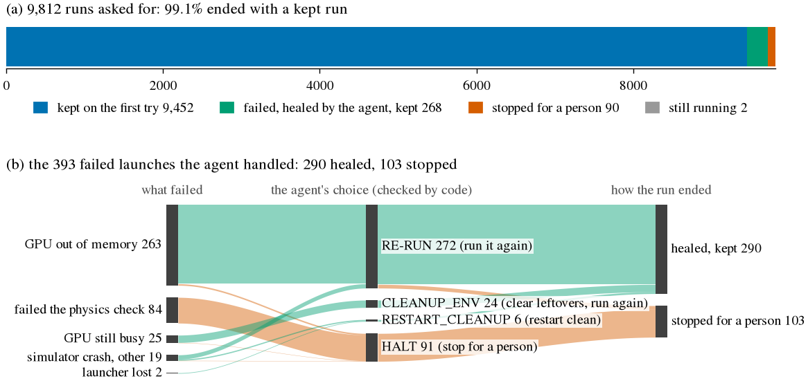
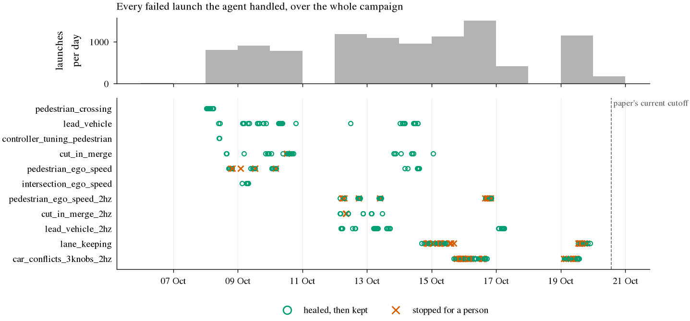

# Self-healing: every failed launch, with its evidence

Written by `harness/healing_ledger.py` from the study queues; nothing here is
typed by hand. Rerun it to check: `uv run python research/harness/healing_ledger.py`.
Each row links to the raw queue entry, which holds the error lines the agent
was shown, a snapshot of the machine (GPU memory, containers, disk), the
commands the agent ran to look, its answer, and the code check's verdict.

## The numbers

| | whole campaign so far | to the paper's cutoff (20 Oct 13:30 UTC) |
|---|---|---|
| runs asked for (launched) | 9,812 | 9,790 |
| launches, retries included | 10,090 | 10,068 |
| kept on the first try | 9,452 | 9,432 |
| failed launches handed to the agent | 393 | 393 |
| ... healed, then kept | 290 | 290 |
| ... stopped for a person | 103 | 103 |
| runs that ended kept | 9,720 (99.1%) | 9,700 (99.1%) |
| runs still running | 2 | 0 |
| agent's choice passed the code check | 393 of 393 | 393 of 393 |
| retry ran exactly the settings asked for | 393 of 393 | 393 of 393 |
| agent's time per diagnosis, median | 8 s | 8 s |

A run is one setting the search asked for; a launch is one try at it.
Failed launches count each try, so one run can fail more than once.
"Failed the physics check" is the gate working, not a heal that failed:
the run came back physically wrong (the reported speed disagrees with the
motion, or the plan shifted less than the lateral shift asked for), so a
rerun would give the same wrong run and the agent stops it. Leaving those
out, the agent healed 290 of 309 launches that failed for operational reasons (GPU, simulator, launcher).

Every code-check verdict here is "accepted": in production the agent never
chose an action the check refuses. That the check does refuse bad actions is
shown separately, by trying every possible answer against every failure
state (FACTS "Exhaustive check") and by planted faults (`VALIDITY.md`).

## What failed and what the agent chose

| what failed | count | the agent's choice | healed | stopped |
|---|---|---|---|---|
| GPU out of memory | 263 | RE-RUN 258, HALT 5 | 246 | 17 |
| failed the physics check | 84 | HALT 84 | 0 | 84 |
| GPU still busy | 25 | CLEANUP_ENV 24, HALT 1 | 24 | 1 |
| simulator crash, other | 19 | RE-RUN 14, RESTART_CLEANUP 4, HALT 1 | 18 | 1 |
| launcher lost | 2 | RESTART_CLEANUP 2 | 2 | 0 |

## One example of each kind

**GPU out of memory**: [pedestrian_crossing_hybrid_001](https://github.com/willv678/simgate/blob/main/studies/pedestrian_crossing/hybrid/queue/001_pedestrian_crossing_hybrid_001.json), attempt 1, 2026-10-08T00:57 UTC.
Status the agent saw: `wizard_exit_code: 1; postflight_failed: metrics file not found (no metrics.parquet)`. It looked at: `nvidia-smi; docker ps`; `Grep: (?i)out of memory|Process \d+ has|nvidia|gpu`; `Grep: Process \d+ has [0-9.]+ \w+ memory in use`.
It chose RE-RUN (run it again); the code check: accepted; then: attempt 2: kept.

**failed the physics check**: [pedestrian_ego_speed_random_009](https://github.com/willv678/simgate/blob/main/studies/pedestrian_ego_speed/random/queue/009_pedestrian_ego_speed_random_009.json), attempt 1, 2026-10-08T19:03 UTC.
Status the agent saw: `physics: max_abs_accel 10.7 > 10.0`. It looked at: `ls /home/willvarner/alpasim/diag/pedestrian_ego_speed_random_009`; `Grep: (?i)accel|physics|speed_scale|seed`; `df -h /home/willvarner/alpasim/diag/pedestrian_ego_speed_random_009`; `Grep: (?i)warn|error|accel|clamp|limit`.
It chose HALT (stop for a person); the code check: accepted; then: stopped.

**GPU still busy**: [pedestrian_crossing_rules_003_a2](https://github.com/willv678/simgate/blob/main/studies/pedestrian_crossing/rules/queue/008_pedestrian_crossing_rules_003_a2.json), attempt 2, 2026-10-08T01:16 UTC.
Status the agent saw: `environment: GPU free 9886 MiB < 10500 MiB`. It looked at: `nvidia-smi; docker ps -a; docker network ls`; `Glob: **/*`; `Read: /home/willvarner/.claude/projects/-tmp-tmp5-5f4j49/1dd1e2f9-1ee3`.
It chose CLEANUP_ENV (clear leftovers, run again); the code check: accepted; then: relaunched in place, kept.

**simulator crash, other**: [pedestrian_crossing_rules_003](https://github.com/willv678/simgate/blob/main/studies/pedestrian_crossing/rules/queue/003_pedestrian_crossing_rules_003.json), attempt 1, 2026-10-08T01:02 UTC.
Status the agent saw: `wizard_exit_code: 1; postflight_failed: metrics file not found (no metrics.parquet)`. It looked at: `Grep: Bind|port is already|address already`; `docker ps -a --format '{{.Names}}\t{{.Status}}\t{{.Ports}}'`; `Grep: pedestrian_crossing_rules_003|Up `.
It chose RE-RUN (run it again); the code check: accepted; then: attempt 2: kept.

**launcher lost**: [cut_in_merge_2hz_hybrid_r2_040](https://github.com/willv678/simgate/blob/main/studies/cut_in_merge_2hz/hybrid_r2/queue/040_cut_in_merge_2hz_hybrid_r2_040.json), attempt 1, 2026-10-12T21:14 UTC.
Status the agent saw: `process_lost: launcher gone, no exit code`. It looked at: `docker ps -a --format '{{.Names}} {{.Status}}' | head -30; tail -5 ./c`.
It chose RESTART_CLEANUP (restart clean); the code check: accepted; then: attempt 2: kept.

## Every failed launch

| # | when (UTC) | study / arm | run (raw entry) | try | what failed | agent looked | chose | check | then | same settings |
|---|---|---|---|---|---|---|---|---|---|---|
| 1 | 10-08 00:57 | pedestrian_crossing / hybrid | [hybrid_001](https://github.com/willv678/simgate/blob/main/studies/pedestrian_crossing/hybrid/queue/001_pedestrian_crossing_hybrid_001.json) | 1 | GPU out of memory | 3 commands | RE-RUN | accepted | attempt 2: kept | yes |
| 2 | 10-08 01:02 | pedestrian_crossing / rules | [rules_003](https://github.com/willv678/simgate/blob/main/studies/pedestrian_crossing/rules/queue/003_pedestrian_crossing_rules_003.json) | 1 | simulator crash, other | 3 commands | RE-RUN | accepted | attempt 2: kept | yes |
| 3 | 10-08 01:16 | pedestrian_crossing / rules | [rules_003_a2](https://github.com/willv678/simgate/blob/main/studies/pedestrian_crossing/rules/queue/008_pedestrian_crossing_rules_003_a2.json) | 2 | GPU still busy | 3 commands | CLEANUP_ENV | accepted | relaunched in place, kept | yes |
| 4 | 10-08 01:45 | pedestrian_crossing / rules | [rules_016](https://github.com/willv678/simgate/blob/main/studies/pedestrian_crossing/rules/queue/017_pedestrian_crossing_rules_016.json) | 1 | GPU out of memory | 2 commands | RE-RUN | accepted | attempt 2: kept | yes |
| 5 | 10-08 02:30 | pedestrian_crossing / hybrid | [hybrid_031](https://github.com/willv678/simgate/blob/main/studies/pedestrian_crossing/hybrid/queue/032_pedestrian_crossing_hybrid_031.json) | 1 | GPU out of memory | 2 commands | RE-RUN | accepted | attempt 2: kept | yes |
| 6 | 10-08 03:09 | pedestrian_crossing / rules | [rules_043](https://github.com/willv678/simgate/blob/main/studies/pedestrian_crossing/rules/queue/045_pedestrian_crossing_rules_043.json) | 1 | simulator crash, other | 5 commands | RE-RUN | accepted | attempt 2: kept | yes |
| 7 | 10-08 03:42 | pedestrian_crossing / llm | [001](https://github.com/willv678/simgate/blob/main/studies/pedestrian_crossing/queue/001_pedestrian_crossing_001.json) | 1 | GPU still busy | 2 commands | CLEANUP_ENV | accepted | relaunched in place, kept | yes |
| 8 | 10-08 05:03 | pedestrian_crossing / random | [random_023](https://github.com/willv678/simgate/blob/main/studies/pedestrian_crossing/random/queue/023_pedestrian_crossing_random_023.json) | 1 | GPU still busy | 3 commands | CLEANUP_ENV | accepted | relaunched in place, kept | yes |
| 9 | 10-08 05:30 | pedestrian_crossing / llm | [036](https://github.com/willv678/simgate/blob/main/studies/pedestrian_crossing/queue/036_pedestrian_crossing_036.json) | 1 | GPU out of memory | 1 commands | RE-RUN | accepted | attempt 2: kept | yes |
| 10 | 10-08 05:51 | pedestrian_crossing / random | [random_037](https://github.com/willv678/simgate/blob/main/studies/pedestrian_crossing/random/queue/037_pedestrian_crossing_random_037.json) | 1 | GPU still busy | 2 commands | CLEANUP_ENV | accepted | relaunched in place, kept | yes |
| 11 | 10-08 05:56 | pedestrian_crossing / random | [random_039](https://github.com/willv678/simgate/blob/main/studies/pedestrian_crossing/random/queue/039_pedestrian_crossing_random_039.json) | 1 | GPU out of memory | 2 commands | RE-RUN | accepted | attempt 2: kept | yes |
| 12 | 10-08 09:52 | lead_vehicle / llm | [018](https://github.com/willv678/simgate/blob/main/studies/lead_vehicle/queue/018_lead_vehicle_018.json) | 1 | GPU out of memory | 1 commands | RE-RUN | accepted | attempt 2: kept | yes |
| 13 | 10-08 10:10 | controller_tuning_pedestrian / hybrid | [hybrid_001_linear](https://github.com/willv678/simgate/blob/main/studies/controller_tuning_pedestrian/hybrid/queue/001_controller_tuning_pedestrian_hybrid_001_linear.json) | 1 | GPU still busy | 4 commands | CLEANUP_ENV | accepted | relaunched in place, kept | yes |
| 14 | 10-08 10:34 | controller_tuning_pedestrian / hybrid | [hybrid_005_linear](https://github.com/willv678/simgate/blob/main/studies/controller_tuning_pedestrian/hybrid/queue/009_controller_tuning_pedestrian_hybrid_005_linear.json) | 1 | GPU out of memory | 3 commands | RE-RUN | accepted | attempt 2: kept | yes |
| 15 | 10-08 10:39 | lead_vehicle / hybrid | [hybrid_039](https://github.com/willv678/simgate/blob/main/studies/lead_vehicle/hybrid/queue/039_lead_vehicle_hybrid_039.json) | 1 | GPU out of memory | 1 commands | RE-RUN | accepted | attempt 2: kept | yes |
| 16 | 10-08 15:15 | cut_in_merge / hybrid | [hybrid_003](https://github.com/willv678/simgate/blob/main/studies/cut_in_merge/hybrid/queue/003_cut_in_merge_hybrid_003.json) | 1 | GPU out of memory | 1 commands | RE-RUN | accepted | attempt 2: kept | yes |
| 17 | 10-08 15:50 | cut_in_merge / hybrid | [hybrid_014](https://github.com/willv678/simgate/blob/main/studies/cut_in_merge/hybrid/queue/015_cut_in_merge_hybrid_014.json) | 1 | GPU out of memory | 4 commands | RE-RUN | accepted | attempt 2: kept | yes |
| 18 | 10-08 17:05 | pedestrian_ego_speed / hybrid | [hybrid_001](https://github.com/willv678/simgate/blob/main/studies/pedestrian_ego_speed/hybrid/queue/001_pedestrian_ego_speed_hybrid_001.json) | 1 | GPU still busy | 2 commands | CLEANUP_ENV | accepted | relaunched in place, kept | yes |
| 19 | 10-08 17:54 | pedestrian_ego_speed / hybrid | [hybrid_017](https://github.com/willv678/simgate/blob/main/studies/pedestrian_ego_speed/hybrid/queue/017_pedestrian_ego_speed_hybrid_017.json) | 1 | GPU out of memory | 3 commands | RE-RUN | accepted | attempt 2: kept | yes |
| 20 | 10-08 18:24 | pedestrian_ego_speed / hybrid | [hybrid_026](https://github.com/willv678/simgate/blob/main/studies/pedestrian_ego_speed/hybrid/queue/027_pedestrian_ego_speed_hybrid_026.json) | 1 | GPU still busy | 2 commands | CLEANUP_ENV | accepted | relaunched in place, kept | yes |
| 21 | 10-08 19:03 | pedestrian_ego_speed / random | [random_009](https://github.com/willv678/simgate/blob/main/studies/pedestrian_ego_speed/random/queue/009_pedestrian_ego_speed_random_009.json) | 1 | failed the physics check | 4 commands | HALT | accepted | stopped | yes |
| 22 | 10-08 19:13 | pedestrian_ego_speed / llm | [014](https://github.com/willv678/simgate/blob/main/studies/pedestrian_ego_speed/queue/014_pedestrian_ego_speed_014.json) | 1 | simulator crash, other | 2 commands | RE-RUN | accepted | attempt 2: kept | yes |
| 23 | 10-08 19:21 | pedestrian_ego_speed / random | [random_015](https://github.com/willv678/simgate/blob/main/studies/pedestrian_ego_speed/random/queue/015_pedestrian_ego_speed_random_015.json) | 1 | GPU out of memory | 1 commands | RE-RUN | accepted | attempt 2: failed again | yes |
| 24 | 10-08 19:37 | pedestrian_ego_speed / random | [random_015_a2](https://github.com/willv678/simgate/blob/main/studies/pedestrian_ego_speed/random/queue/021_pedestrian_ego_speed_random_015_a2.json) | 2 | GPU out of memory | 2 commands | RE-RUN | accepted | attempt 3: kept | yes |
| 25 | 10-08 19:43 | pedestrian_ego_speed / random | [random_021](https://github.com/willv678/simgate/blob/main/studies/pedestrian_ego_speed/random/queue/023_pedestrian_ego_speed_random_021.json) | 1 | GPU out of memory | 1 commands | RE-RUN | accepted | attempt 2: kept | yes |
| 26 | 10-08 20:05 | pedestrian_ego_speed / random | [random_029](https://github.com/willv678/simgate/blob/main/studies/pedestrian_ego_speed/random/queue/031_pedestrian_ego_speed_random_029.json) | 1 | failed the physics check | 1 commands | HALT | accepted | stopped | yes |
| 27 | 10-09 01:58 | pedestrian_ego_speed / random_confirm | [random_confirm_009](https://github.com/willv678/simgate/blob/main/studies/pedestrian_ego_speed/random_confirm/queue/009_pedestrian_ego_speed_random_confirm_009.json) | 1 | failed the physics check | 2 commands | HALT | accepted | stopped | yes |
| 28 | 10-09 03:07 | intersection_ego_speed / llm | [032](https://github.com/willv678/simgate/blob/main/studies/intersection_ego_speed/queue/032_intersection_ego_speed_032.json) | 1 | GPU still busy | 3 commands | CLEANUP_ENV | accepted | relaunched in place, kept | yes |
| 29 | 10-09 03:37 | lead_vehicle / random_confirm | [random_confirm_001](https://github.com/willv678/simgate/blob/main/studies/lead_vehicle/random_confirm/queue/001_lead_vehicle_random_confirm_001.json) | 1 | simulator crash, other | 4 commands | RESTART_CLEANUP | accepted | attempt 2: kept | yes |
| 30 | 10-09 04:20 | lead_vehicle / random_confirm | [random_confirm_015](https://github.com/willv678/simgate/blob/main/studies/lead_vehicle/random_confirm/queue/016_lead_vehicle_random_confirm_015.json) | 1 | GPU out of memory | 1 commands | RE-RUN | accepted | attempt 2: failed again | yes |
| 31 | 10-09 04:31 | cut_in_merge / random_confirm | [random_confirm_009](https://github.com/willv678/simgate/blob/main/studies/cut_in_merge/random_confirm/queue/009_cut_in_merge_random_confirm_009.json) | 1 | GPU out of memory | 3 commands | RE-RUN | accepted | attempt 2: kept | yes |
| 32 | 10-09 04:38 | lead_vehicle / random_confirm | [random_confirm_015_a2](https://github.com/willv678/simgate/blob/main/studies/lead_vehicle/random_confirm/queue/023_lead_vehicle_random_confirm_015_a2.json) | 2 | GPU out of memory | 3 commands | RE-RUN | accepted | attempt 3: kept | yes |
| 33 | 10-09 06:30 | intersection_ego_speed / random_confirm | [random_confirm_006](https://github.com/willv678/simgate/blob/main/studies/intersection_ego_speed/random_confirm/queue/006_intersection_ego_speed_random_confirm_006.json) | 1 | GPU out of memory | 3 commands | RE-RUN | accepted | attempt 2: kept | yes |
| 34 | 10-09 06:50 | intersection_ego_speed / random_confirm | [random_confirm_012](https://github.com/willv678/simgate/blob/main/studies/intersection_ego_speed/random_confirm/queue/013_intersection_ego_speed_random_confirm_012.json) | 1 | GPU out of memory | 1 commands | RE-RUN | accepted | attempt 2: kept | yes |
| 35 | 10-09 07:04 | intersection_ego_speed / random_confirm | [random_confirm_016](https://github.com/willv678/simgate/blob/main/studies/intersection_ego_speed/random_confirm/queue/018_intersection_ego_speed_random_confirm_016.json) | 1 | GPU out of memory | 2 commands | RE-RUN | accepted | attempt 2: kept | yes |
| 36 | 10-09 07:30 | intersection_ego_speed / random_confirm | [random_confirm_024](https://github.com/willv678/simgate/blob/main/studies/intersection_ego_speed/random_confirm/queue/027_intersection_ego_speed_random_confirm_024.json) | 1 | GPU out of memory | 1 commands | RE-RUN | accepted | attempt 2: kept | yes |
| 37 | 10-09 07:35 | lead_vehicle / rules_corners | [rules_corners_014](https://github.com/willv678/simgate/blob/main/studies/lead_vehicle/rules_corners/queue/014_lead_vehicle_rules_corners_014.json) | 1 | GPU out of memory | 3 commands | RE-RUN | accepted | attempt 2: kept | yes |
| 38 | 10-09 07:55 | intersection_ego_speed / random_confirm | [random_confirm_032](https://github.com/willv678/simgate/blob/main/studies/intersection_ego_speed/random_confirm/queue/036_intersection_ego_speed_random_confirm_032.json) | 1 | GPU out of memory | 1 commands | RE-RUN | accepted | attempt 2: kept | yes |
| 39 | 10-09 08:22 | lead_vehicle / rules_corners | [rules_corners_029](https://github.com/willv678/simgate/blob/main/studies/lead_vehicle/rules_corners/queue/030_lead_vehicle_rules_corners_029.json) | 1 | GPU out of memory | 1 commands | RE-RUN | accepted | attempt 2: kept | yes |
| 40 | 10-09 09:32 | pedestrian_ego_speed / rules_r2 | [rules_r2_002](https://github.com/willv678/simgate/blob/main/studies/pedestrian_ego_speed/rules_r2/queue/002_pedestrian_ego_speed_rules_r2_002.json) | 1 | GPU out of memory | 3 commands | RE-RUN | accepted | attempt 2: kept | yes |
| 41 | 10-09 11:00 | pedestrian_ego_speed / hybrid_r2 | [hybrid_r2_001](https://github.com/willv678/simgate/blob/main/studies/pedestrian_ego_speed/hybrid_r2/queue/001_pedestrian_ego_speed_hybrid_r2_001.json) | 1 | GPU out of memory | 3 commands | RE-RUN | accepted | attempt 2: kept | yes |
| 42 | 10-09 11:53 | pedestrian_ego_speed / hybrid_r2 | [hybrid_r2_019](https://github.com/willv678/simgate/blob/main/studies/pedestrian_ego_speed/hybrid_r2/queue/020_pedestrian_ego_speed_hybrid_r2_019.json) | 1 | GPU out of memory | 1 commands | RE-RUN | accepted | attempt 2: kept | yes |
| 43 | 10-09 11:58 | pedestrian_ego_speed / llm_r2 | [llm_r2_003](https://github.com/willv678/simgate/blob/main/studies/pedestrian_ego_speed/llm_r2/queue/003_pedestrian_ego_speed_llm_r2_003.json) | 1 | GPU out of memory | 1 commands | RE-RUN | accepted | attempt 2: kept | yes |
| 44 | 10-09 12:48 | pedestrian_ego_speed / random_confirm_r2 | [random_confirm_r2_005](https://github.com/willv678/simgate/blob/main/studies/pedestrian_ego_speed/random_confirm_r2/queue/005_pedestrian_ego_speed_random_confirm_r2_005.json) | 1 | failed the physics check | 1 commands | HALT | accepted | stopped | yes |
| 45 | 10-09 12:52 | pedestrian_ego_speed / llm_r2 | [llm_r2_020](https://github.com/willv678/simgate/blob/main/studies/pedestrian_ego_speed/llm_r2/queue/021_pedestrian_ego_speed_llm_r2_020.json) | 1 | failed the physics check | 1 commands | HALT | accepted | stopped | yes |
| 46 | 10-09 12:58 | pedestrian_ego_speed / random_confirm_r2 | [random_confirm_r2_008](https://github.com/willv678/simgate/blob/main/studies/pedestrian_ego_speed/random_confirm_r2/queue/008_pedestrian_ego_speed_random_confirm_r2_008.json) | 1 | GPU still busy | 2 commands | CLEANUP_ENV | accepted | relaunched in place, kept | yes |
| 47 | 10-09 14:30 | lead_vehicle / rules_r2 | [rules_r2_002](https://github.com/willv678/simgate/blob/main/studies/lead_vehicle/rules_r2/queue/002_lead_vehicle_rules_r2_002.json) | 1 | GPU out of memory | 3 commands | RE-RUN | accepted | attempt 2: failed again | yes |
| 48 | 10-09 14:46 | lead_vehicle / rules_r2 | [rules_r2_002_a2](https://github.com/willv678/simgate/blob/main/studies/lead_vehicle/rules_r2/queue/008_lead_vehicle_rules_r2_002_a2.json) | 2 | GPU out of memory | 4 commands | RE-RUN | accepted | attempt 3: kept | yes |
| 49 | 10-09 15:42 | lead_vehicle / rules_r2 | [rules_r2_025](https://github.com/willv678/simgate/blob/main/studies/lead_vehicle/rules_r2/queue/027_lead_vehicle_rules_r2_025.json) | 1 | simulator crash, other | 3 commands | RE-RUN | accepted | attempt 2: kept | yes |
| 50 | 10-09 15:47 | lead_vehicle / hybrid_r2 | [hybrid_r2_024](https://github.com/willv678/simgate/blob/main/studies/lead_vehicle/hybrid_r2/queue/024_lead_vehicle_hybrid_r2_024.json) | 1 | GPU out of memory | 2 commands | RE-RUN | accepted | attempt 2: kept | yes |
| 51 | 10-09 15:56 | lead_vehicle / rules_r2 | [rules_r2_029](https://github.com/willv678/simgate/blob/main/studies/lead_vehicle/rules_r2/queue/032_lead_vehicle_rules_r2_029.json) | 1 | GPU out of memory | 2 commands | RE-RUN | accepted | attempt 2: kept | yes |
| 52 | 10-09 18:54 | lead_vehicle / random_confirm_r2 | [random_confirm_r2_006](https://github.com/willv678/simgate/blob/main/studies/lead_vehicle/random_confirm_r2/queue/006_lead_vehicle_random_confirm_r2_006.json) | 1 | GPU out of memory | 1 commands | RE-RUN | accepted | attempt 2: kept | yes |
| 53 | 10-09 19:14 | lead_vehicle / random_confirm_r2 | [random_confirm_r2_012](https://github.com/willv678/simgate/blob/main/studies/lead_vehicle/random_confirm_r2/queue/013_lead_vehicle_random_confirm_r2_012.json) | 1 | GPU still busy | 3 commands | CLEANUP_ENV | accepted | relaunched in place, kept | yes |
| 54 | 10-09 20:34 | cut_in_merge / rules_r2 | [rules_r2_031](https://github.com/willv678/simgate/blob/main/studies/cut_in_merge/rules_r2/queue/031_cut_in_merge_rules_r2_031.json) | 1 | GPU out of memory | 2 commands | RE-RUN | accepted | attempt 2: kept | yes |
| 55 | 10-09 20:52 | lead_vehicle / random_confirm_r2 | [random_confirm_r2_045](https://github.com/willv678/simgate/blob/main/studies/lead_vehicle/random_confirm_r2/queue/046_lead_vehicle_random_confirm_r2_045.json) | 1 | GPU out of memory | 2 commands | RE-RUN | accepted | attempt 2: kept | yes |
| 56 | 10-09 22:11 | cut_in_merge / hybrid_r2 | [hybrid_r2_021](https://github.com/willv678/simgate/blob/main/studies/cut_in_merge/hybrid_r2/queue/021_cut_in_merge_hybrid_r2_021.json) | 1 | GPU out of memory | 2 commands | RE-RUN | accepted | attempt 2: kept | yes |
| 57 | 10-09 22:54 | cut_in_merge / llm_r2 | [llm_r2_022](https://github.com/willv678/simgate/blob/main/studies/cut_in_merge/llm_r2/queue/022_cut_in_merge_llm_r2_022.json) | 1 | GPU out of memory | 1 commands | RE-RUN | accepted | attempt 2: kept | yes |
| 58 | 10-09 23:11 | cut_in_merge / random_confirm_r2 | [random_confirm_r2_003](https://github.com/willv678/simgate/blob/main/studies/cut_in_merge/random_confirm_r2/queue/003_cut_in_merge_random_confirm_r2_003.json) | 1 | GPU out of memory | 2 commands | RE-RUN | accepted | attempt 2: kept | yes |
| 59 | 10-10 00:54 | cut_in_merge / random_confirm_r2 | [random_confirm_r2_037](https://github.com/willv678/simgate/blob/main/studies/cut_in_merge/random_confirm_r2/queue/038_cut_in_merge_random_confirm_r2_037.json) | 1 | GPU out of memory | 2 commands | RE-RUN | accepted | attempt 2: kept | yes |
| 60 | 10-10 01:19 | pedestrian_ego_speed / rules_r3 | [rules_r3_001](https://github.com/willv678/simgate/blob/main/studies/pedestrian_ego_speed/rules_r3/queue/001_pedestrian_ego_speed_rules_r3_001.json) | 1 | GPU out of memory | 3 commands | RE-RUN | accepted | attempt 2: kept | yes |
| 61 | 10-10 01:25 | pedestrian_ego_speed / rules_r3 | [rules_r3_003](https://github.com/willv678/simgate/blob/main/studies/pedestrian_ego_speed/rules_r3/queue/003_pedestrian_ego_speed_rules_r3_003.json) | 1 | GPU still busy | 2 commands | CLEANUP_ENV | accepted | relaunched in place, kept | yes |
| 62 | 10-10 01:53 | pedestrian_ego_speed / hybrid_r3 | [hybrid_r3_001](https://github.com/willv678/simgate/blob/main/studies/pedestrian_ego_speed/hybrid_r3/queue/001_pedestrian_ego_speed_hybrid_r3_001.json) | 1 | GPU out of memory | 1 commands | RE-RUN | accepted | attempt 2: kept | yes |
| 63 | 10-10 02:23 | pedestrian_ego_speed / rules_r3 | [rules_r3_021](https://github.com/willv678/simgate/blob/main/studies/pedestrian_ego_speed/rules_r3/queue/022_pedestrian_ego_speed_rules_r3_021.json) | 1 | GPU still busy | 2 commands | CLEANUP_ENV | accepted | relaunched in place, kept | yes |
| 64 | 10-10 03:30 | pedestrian_ego_speed / llm_r3 | [llm_r3_013](https://github.com/willv678/simgate/blob/main/studies/pedestrian_ego_speed/llm_r3/queue/013_pedestrian_ego_speed_llm_r3_013.json) | 1 | GPU out of memory | 1 commands | RE-RUN | accepted | attempt 2: kept | yes |
| 65 | 10-10 03:57 | pedestrian_ego_speed / llm_r3 | [llm_r3_021](https://github.com/willv678/simgate/blob/main/studies/pedestrian_ego_speed/llm_r3/queue/022_pedestrian_ego_speed_llm_r3_021.json) | 1 | GPU out of memory | 1 commands | RE-RUN | accepted | attempt 2: kept | yes |
| 66 | 10-10 04:13 | pedestrian_ego_speed / llm_r3 | [llm_r3_027](https://github.com/willv678/simgate/blob/main/studies/pedestrian_ego_speed/llm_r3/queue/028_pedestrian_ego_speed_llm_r3_027.json) | 1 | failed the physics check | 2 commands | HALT | accepted | stopped | yes |
| 67 | 10-10 04:28 | pedestrian_ego_speed / random_confirm_r3 | [random_confirm_r3_021](https://github.com/willv678/simgate/blob/main/studies/pedestrian_ego_speed/random_confirm_r3/queue/021_pedestrian_ego_speed_random_confirm_r3_021.json) | 1 | GPU still busy | 2 commands | CLEANUP_ENV | accepted | relaunched in place, kept | yes |
| 68 | 10-10 06:18 | lead_vehicle / hybrid_r3 | [hybrid_r3_018](https://github.com/willv678/simgate/blob/main/studies/lead_vehicle/hybrid_r3/queue/018_lead_vehicle_hybrid_r3_018.json) | 1 | GPU out of memory | 3 commands | RE-RUN | accepted | attempt 2: kept | yes |
| 69 | 10-10 06:54 | lead_vehicle / hybrid_r3 | [hybrid_r3_029](https://github.com/willv678/simgate/blob/main/studies/lead_vehicle/hybrid_r3/queue/030_lead_vehicle_hybrid_r3_029.json) | 1 | simulator crash, other | 4 commands | RE-RUN | accepted | attempt 2: kept | yes |
| 70 | 10-10 07:00 | lead_vehicle / rules_r3 | [rules_r3_041](https://github.com/willv678/simgate/blob/main/studies/lead_vehicle/rules_r3/queue/041_lead_vehicle_rules_r3_041.json) | 1 | GPU out of memory | 1 commands | RE-RUN | accepted | attempt 2: kept | yes |
| 71 | 10-10 07:39 | lead_vehicle / hybrid_r3 | [hybrid_r3_043](https://github.com/willv678/simgate/blob/main/studies/lead_vehicle/hybrid_r3/queue/045_lead_vehicle_hybrid_r3_043.json) | 1 | GPU out of memory | 1 commands | RE-RUN | accepted | attempt 2: kept | yes |
| 72 | 10-10 07:56 | lead_vehicle / llm_r3 | [llm_r3_010](https://github.com/willv678/simgate/blob/main/studies/lead_vehicle/llm_r3/queue/010_lead_vehicle_llm_r3_010.json) | 1 | GPU out of memory | 1 commands | RE-RUN | accepted | attempt 2: kept | yes |
| 73 | 10-10 08:59 | lead_vehicle / random_confirm_r3 | [random_confirm_r3_020](https://github.com/willv678/simgate/blob/main/studies/lead_vehicle/random_confirm_r3/queue/020_lead_vehicle_random_confirm_r3_020.json) | 1 | GPU out of memory | 2 commands | RE-RUN | accepted | attempt 2: kept | yes |
| 74 | 10-10 09:07 | lead_vehicle / random_confirm_r3 | [random_confirm_r3_022](https://github.com/willv678/simgate/blob/main/studies/lead_vehicle/random_confirm_r3/queue/023_lead_vehicle_random_confirm_r3_022.json) | 1 | GPU out of memory | 2 commands | RE-RUN | accepted | attempt 2: kept | yes |
| 75 | 10-10 09:40 | cut_in_merge / rules_r3 | [rules_r3_009](https://github.com/willv678/simgate/blob/main/studies/cut_in_merge/rules_r3/queue/009_cut_in_merge_rules_r3_009.json) | 1 | GPU out of memory | 1 commands | RE-RUN | accepted | attempt 2: kept | yes |
| 76 | 10-10 12:28 | cut_in_merge / random_confirm_r3 | [random_confirm_r3_002](https://github.com/willv678/simgate/blob/main/studies/cut_in_merge/random_confirm_r3/queue/002_cut_in_merge_random_confirm_r3_002.json) | 1 | GPU still busy | 1 commands | CLEANUP_ENV | accepted | relaunched in place, kept | yes |
| 77 | 10-10 12:33 | cut_in_merge / llm_r3 | [llm_r3_011](https://github.com/willv678/simgate/blob/main/studies/cut_in_merge/llm_r3/queue/011_cut_in_merge_llm_r3_011.json) | 1 | GPU still busy | 2 commands | HALT | accepted | stopped | yes |
| 78 | 10-10 13:22 | cut_in_merge / llm_r3 | [llm_r3_028](https://github.com/willv678/simgate/blob/main/studies/cut_in_merge/llm_r3/queue/028_cut_in_merge_llm_r3_028.json) | 1 | GPU out of memory | 2 commands | RE-RUN | accepted | attempt 2: kept | yes |
| 79 | 10-10 13:50 | cut_in_merge / random_confirm_r3 | [random_confirm_r3_029](https://github.com/willv678/simgate/blob/main/studies/cut_in_merge/random_confirm_r3/queue/029_cut_in_merge_random_confirm_r3_029.json) | 1 | GPU out of memory | 3 commands | RE-RUN | accepted | attempt 2: kept | yes |
| 80 | 10-10 13:54 | cut_in_merge / llm_r3 | [llm_r3_037](https://github.com/willv678/simgate/blob/main/studies/cut_in_merge/llm_r3/queue/038_cut_in_merge_llm_r3_037.json) | 1 | GPU still busy | 2 commands | CLEANUP_ENV | accepted | relaunched in place, kept | yes |
| 81 | 10-10 14:17 | cut_in_merge / random_confirm_r3 | [random_confirm_r3_037](https://github.com/willv678/simgate/blob/main/studies/cut_in_merge/random_confirm_r3/queue/038_cut_in_merge_random_confirm_r3_037.json) | 1 | GPU out of memory | 2 commands | RE-RUN | accepted | attempt 2: kept | yes |
| 82 | 10-10 14:27 | cut_in_merge / random_confirm_r3 | [random_confirm_r3_041](https://github.com/willv678/simgate/blob/main/studies/cut_in_merge/random_confirm_r3/queue/042_cut_in_merge_random_confirm_r3_041.json) | 1 | GPU out of memory | 1 commands | RE-RUN | accepted | attempt 2: kept | yes |
| 83 | 10-10 14:55 | cut_in_merge / rules_r4 | [rules_r4_002](https://github.com/willv678/simgate/blob/main/studies/cut_in_merge/rules_r4/queue/002_cut_in_merge_rules_r4_002.json) | 1 | simulator crash, other | 5 commands | RE-RUN | accepted | attempt 2: kept | yes |
| 84 | 10-10 15:25 | cut_in_merge / rules_r4 | [rules_r4_011](https://github.com/willv678/simgate/blob/main/studies/cut_in_merge/rules_r4/queue/012_cut_in_merge_rules_r4_011.json) | 1 | GPU still busy | 2 commands | CLEANUP_ENV | accepted | relaunched in place, kept | yes |
| 85 | 10-10 15:46 | cut_in_merge / hybrid_r4 | [hybrid_r4_010](https://github.com/willv678/simgate/blob/main/studies/cut_in_merge/hybrid_r4/queue/010_cut_in_merge_hybrid_r4_010.json) | 1 | GPU still busy | 2 commands | CLEANUP_ENV | accepted | relaunched in place, kept | yes |
| 86 | 10-10 15:58 | cut_in_merge / rules_r4 | [rules_r4_022](https://github.com/willv678/simgate/blob/main/studies/cut_in_merge/rules_r4/queue/023_cut_in_merge_rules_r4_022.json) | 1 | GPU out of memory | 2 commands | RE-RUN | accepted | attempt 2: failed again | yes |
| 87 | 10-10 16:16 | cut_in_merge / rules_r4 | [rules_r4_022_a2](https://github.com/willv678/simgate/blob/main/studies/cut_in_merge/rules_r4/queue/029_cut_in_merge_rules_r4_022_a2.json) | 2 | GPU out of memory | 2 commands | RE-RUN | accepted | attempt 3: kept | yes |
| 88 | 10-10 16:23 | cut_in_merge / rules_r4 | [rules_r4_028](https://github.com/willv678/simgate/blob/main/studies/cut_in_merge/rules_r4/queue/031_cut_in_merge_rules_r4_028.json) | 1 | GPU out of memory | 1 commands | RE-RUN | accepted | attempt 2: kept | yes |
| 89 | 10-10 17:29 | cut_in_merge / rules_r4 | [rules_r4_050](https://github.com/willv678/simgate/blob/main/studies/cut_in_merge/rules_r4/queue/054_cut_in_merge_rules_r4_050.json) | 1 | GPU out of memory | 1 commands | RE-RUN | accepted | attempt 2: kept | yes |
| 90 | 10-10 19:08 | lead_vehicle / llm_r4 | [llm_r4_022](https://github.com/willv678/simgate/blob/main/studies/lead_vehicle/llm_r4/queue/022_lead_vehicle_llm_r4_022.json) | 1 | GPU out of memory | 2 commands | RE-RUN | accepted | attempt 2: kept | yes |
| 91 | 10-12 03:51 | pedestrian_ego_speed_2hz / hybrid | [hybrid_033](https://github.com/willv678/simgate/blob/main/studies/pedestrian_ego_speed_2hz/hybrid/queue/033_pedestrian_ego_speed_2hz_hybrid_033.json) | 1 | GPU out of memory | 1 commands | RE-RUN | accepted | attempt 2: kept | yes |
| 92 | 10-12 03:57 | cut_in_merge_2hz / rules_v3 | [rules_v3_013](https://github.com/willv678/simgate/blob/main/studies/cut_in_merge_2hz/rules_v3/queue/013_cut_in_merge_2hz_rules_v3_013.json) | 1 | GPU out of memory | 1 commands | RE-RUN | accepted | attempt 2: kept | yes |
| 93 | 10-12 04:10 | cut_in_merge_2hz / rules_v3 | [rules_v3_019](https://github.com/willv678/simgate/blob/main/studies/cut_in_merge_2hz/rules_v3/queue/020_cut_in_merge_2hz_rules_v3_019.json) | 1 | GPU out of memory | 1 commands | RE-RUN | accepted | attempt 2: kept | yes |
| 94 | 10-12 04:35 | lead_vehicle_2hz / rules_v3 | [rules_v3_004](https://github.com/willv678/simgate/blob/main/studies/lead_vehicle_2hz/rules_v3/queue/004_lead_vehicle_2hz_rules_v3_004.json) | 1 | GPU out of memory | 2 commands | RE-RUN | accepted | attempt 2: kept | yes |
| 95 | 10-12 04:36 | lead_vehicle_2hz / rules_v3 | [rules_v3_005](https://github.com/willv678/simgate/blob/main/studies/lead_vehicle_2hz/rules_v3/queue/005_lead_vehicle_2hz_rules_v3_005.json) | 1 | GPU out of memory | 1 commands | RE-RUN | accepted | attempt 2: kept | yes |
| 96 | 10-12 04:57 | lead_vehicle_2hz / rules_v3 | [rules_v3_014](https://github.com/willv678/simgate/blob/main/studies/lead_vehicle_2hz/rules_v3/queue/016_lead_vehicle_2hz_rules_v3_014.json) | 1 | GPU out of memory | 1 commands | RE-RUN | accepted | attempt 2: kept | yes |
| 97 | 10-12 05:30 | pedestrian_ego_speed_2hz / llm | [006](https://github.com/willv678/simgate/blob/main/studies/pedestrian_ego_speed_2hz/queue/006_pedestrian_ego_speed_2hz_006.json) | 1 | failed the physics check | 2 commands | HALT | accepted | stopped | yes |
| 98 | 10-12 05:48 | lead_vehicle_2hz / rules_v3 | [rules_v3_040](https://github.com/willv678/simgate/blob/main/studies/lead_vehicle_2hz/rules_v3/queue/043_lead_vehicle_2hz_rules_v3_040.json) | 1 | GPU out of memory | 1 commands | RE-RUN | accepted | attempt 2: kept | yes |
| 99 | 10-12 06:03 | pedestrian_ego_speed_2hz / llm | [023](https://github.com/willv678/simgate/blob/main/studies/pedestrian_ego_speed_2hz/queue/023_pedestrian_ego_speed_2hz_023.json) | 1 | GPU out of memory | 2 commands | RE-RUN | accepted | attempt 2: kept | yes |
| 100 | 10-12 06:15 | pedestrian_ego_speed_2hz / random_confirm | [random_confirm_004](https://github.com/willv678/simgate/blob/main/studies/pedestrian_ego_speed_2hz/random_confirm/queue/004_pedestrian_ego_speed_2hz_random_confirm_004.json) | 1 | failed the physics check | 1 commands | HALT | accepted | stopped | yes |
| 101 | 10-12 07:15 | pedestrian_ego_speed_2hz / random_confirm | [random_confirm_036](https://github.com/willv678/simgate/blob/main/studies/pedestrian_ego_speed_2hz/random_confirm/queue/036_pedestrian_ego_speed_2hz_random_confirm_036.json) | 1 | failed the physics check | 2 commands | HALT | accepted | stopped | yes |
| 102 | 10-12 07:21 | pedestrian_ego_speed_2hz / random_confirm | [random_confirm_039](https://github.com/willv678/simgate/blob/main/studies/pedestrian_ego_speed_2hz/random_confirm/queue/039_pedestrian_ego_speed_2hz_random_confirm_039.json) | 1 | GPU out of memory | 1 commands | RE-RUN | accepted | attempt 2: kept | yes |
| 103 | 10-12 08:12 | cut_in_merge_2hz / rules | [rules_039](https://github.com/willv678/simgate/blob/main/studies/cut_in_merge_2hz/rules/queue/039_cut_in_merge_2hz_rules_039.json) | 1 | GPU out of memory | 4 commands | RE-RUN | accepted | attempt 2: failed again | yes |
| 104 | 10-12 08:25 | cut_in_merge_2hz / rules | [rules_039_a2](https://github.com/willv678/simgate/blob/main/studies/cut_in_merge_2hz/rules/queue/046_cut_in_merge_2hz_rules_039_a2.json) | 2 | GPU out of memory | 1 commands | RE-RUN | accepted | attempt 3: stopped | yes |
| 105 | 10-12 08:27 | cut_in_merge_2hz / rules | [rules_039_a3](https://github.com/willv678/simgate/blob/main/studies/cut_in_merge_2hz/rules/queue/047_cut_in_merge_2hz_rules_039_a3.json) | 3 | GPU out of memory | 0 commands | HALT | accepted | stopped | yes |
| 106 | 10-12 10:00 | cut_in_merge_2hz / random_confirm | [random_confirm_015](https://github.com/willv678/simgate/blob/main/studies/cut_in_merge_2hz/random_confirm/queue/015_cut_in_merge_2hz_random_confirm_015.json) | 1 | GPU out of memory | 1 commands | RE-RUN | accepted | attempt 2: kept | yes |
| 107 | 10-12 10:10 | cut_in_merge_2hz / random_confirm | [random_confirm_019](https://github.com/willv678/simgate/blob/main/studies/cut_in_merge_2hz/random_confirm/queue/020_cut_in_merge_2hz_random_confirm_019.json) | 1 | GPU out of memory | 1 commands | RE-RUN | accepted | attempt 2: kept | yes |
| 108 | 10-12 11:54 | lead_vehicle / llm_r3 | [llm_r3_047](https://github.com/willv678/simgate/blob/main/studies/lead_vehicle/llm_r3/queue/048_lead_vehicle_llm_r3_047.json) | 1 | GPU out of memory | 2 commands | RE-RUN | accepted | attempt 2: kept | yes |
| 109 | 10-12 13:25 | lead_vehicle_2hz / rules | [rules_014](https://github.com/willv678/simgate/blob/main/studies/lead_vehicle_2hz/rules/queue/014_lead_vehicle_2hz_rules_014.json) | 1 | GPU out of memory | 1 commands | RE-RUN | accepted | attempt 2: kept | yes |
| 110 | 10-12 15:10 | lead_vehicle_2hz / llm | [018](https://github.com/willv678/simgate/blob/main/studies/lead_vehicle_2hz/queue/018_lead_vehicle_2hz_018.json) | 1 | GPU out of memory | 3 commands | RE-RUN | accepted | attempt 2: kept | yes |
| 111 | 10-12 15:31 | lead_vehicle_2hz / random_confirm | [random_confirm_009](https://github.com/willv678/simgate/blob/main/studies/lead_vehicle_2hz/random_confirm/queue/009_lead_vehicle_2hz_random_confirm_009.json) | 1 | GPU out of memory | 1 commands | RE-RUN | accepted | attempt 2: kept | yes |
| 112 | 10-12 17:08 | pedestrian_ego_speed_2hz / hybrid_r2 | [hybrid_r2_001](https://github.com/willv678/simgate/blob/main/studies/pedestrian_ego_speed_2hz/hybrid_r2/queue/001_pedestrian_ego_speed_2hz_hybrid_r2_001.json) | 1 | simulator crash, other | 3 commands | RE-RUN | accepted | attempt 2: kept | yes |
| 113 | 10-12 17:35 | pedestrian_ego_speed_2hz / hybrid_r2 | [hybrid_r2_016](https://github.com/willv678/simgate/blob/main/studies/pedestrian_ego_speed_2hz/hybrid_r2/queue/017_pedestrian_ego_speed_2hz_hybrid_r2_016.json) | 1 | GPU out of memory | 3 commands | RE-RUN | accepted | attempt 2: kept | yes |
| 114 | 10-12 17:44 | pedestrian_ego_speed_2hz / llm_r2 | [llm_r2_006](https://github.com/willv678/simgate/blob/main/studies/pedestrian_ego_speed_2hz/llm_r2/queue/006_pedestrian_ego_speed_2hz_llm_r2_006.json) | 1 | failed the physics check | 2 commands | HALT | accepted | stopped | yes |
| 115 | 10-12 17:54 | pedestrian_ego_speed_2hz / llm_r2 | [llm_r2_011](https://github.com/willv678/simgate/blob/main/studies/pedestrian_ego_speed_2hz/llm_r2/queue/011_pedestrian_ego_speed_2hz_llm_r2_011.json) | 1 | simulator crash, other | 5 commands | RE-RUN | accepted | attempt 2: kept | yes |
| 116 | 10-12 18:01 | pedestrian_ego_speed_2hz / llm_r2 | [llm_r2_016](https://github.com/willv678/simgate/blob/main/studies/pedestrian_ego_speed_2hz/llm_r2/queue/016_pedestrian_ego_speed_2hz_llm_r2_016.json) | 1 | GPU out of memory | 1 commands | RE-RUN | accepted | attempt 2: kept | yes |
| 117 | 10-12 18:47 | pedestrian_ego_speed_2hz / llm_r2 | [llm_r2_039](https://github.com/willv678/simgate/blob/main/studies/pedestrian_ego_speed_2hz/llm_r2/queue/041_pedestrian_ego_speed_2hz_llm_r2_039.json) | 1 | GPU out of memory | 1 commands | RE-RUN | accepted | attempt 2: failed again | yes |
| 118 | 10-12 18:50 | pedestrian_ego_speed_2hz / llm_r2 | [llm_r2_039_a2](https://github.com/willv678/simgate/blob/main/studies/pedestrian_ego_speed_2hz/llm_r2/queue/043_pedestrian_ego_speed_2hz_llm_r2_039_a2.json) | 2 | GPU out of memory | 2 commands | RE-RUN | accepted | attempt 3: kept | yes |
| 119 | 10-12 21:14 | cut_in_merge_2hz / hybrid_r2 | [hybrid_r2_040](https://github.com/willv678/simgate/blob/main/studies/cut_in_merge_2hz/hybrid_r2/queue/040_cut_in_merge_2hz_hybrid_r2_040.json) | 1 | launcher lost | 1 commands | RESTART_CLEANUP | accepted | attempt 2: kept | yes |
| 120 | 10-12 21:14 | cut_in_merge_2hz / llm_r2 | [llm_r2_009](https://github.com/willv678/simgate/blob/main/studies/cut_in_merge_2hz/llm_r2/queue/009_cut_in_merge_2hz_llm_r2_009.json) | 1 | launcher lost | 2 commands | RESTART_CLEANUP | accepted | attempt 2: kept | yes |
| 121 | 10-13 03:04 | cut_in_merge_2hz / llm_r2 | [llm_r2_015](https://github.com/willv678/simgate/blob/main/studies/cut_in_merge_2hz/llm_r2/queue/016_cut_in_merge_2hz_llm_r2_015.json) | 1 | simulator crash, other | 1 commands | RE-RUN | accepted | attempt 2: kept | yes |
| 122 | 10-13 03:27 | cut_in_merge_2hz / random_confirm_r2 | [random_confirm_r2_004](https://github.com/willv678/simgate/blob/main/studies/cut_in_merge_2hz/random_confirm_r2/queue/004_cut_in_merge_2hz_random_confirm_r2_004.json) | 1 | GPU out of memory | 2 commands | RE-RUN | accepted | attempt 2: kept | yes |
| 123 | 10-13 05:07 | lead_vehicle_2hz / hybrid_r2 | [hybrid_r2_002](https://github.com/willv678/simgate/blob/main/studies/lead_vehicle_2hz/hybrid_r2/queue/002_lead_vehicle_2hz_hybrid_r2_002.json) | 1 | GPU out of memory | 1 commands | RE-RUN | accepted | attempt 2: kept | yes |
| 124 | 10-13 05:28 | lead_vehicle_2hz / rules_r2 | [rules_r2_036](https://github.com/willv678/simgate/blob/main/studies/lead_vehicle_2hz/rules_r2/queue/036_lead_vehicle_2hz_rules_r2_036.json) | 1 | GPU out of memory | 5 commands | RE-RUN | accepted | attempt 2: kept | yes |
| 125 | 10-13 05:47 | lead_vehicle_2hz / rules_r2 | [rules_r2_046](https://github.com/willv678/simgate/blob/main/studies/lead_vehicle_2hz/rules_r2/queue/047_lead_vehicle_2hz_rules_r2_046.json) | 1 | GPU out of memory | 3 commands | RE-RUN | accepted | attempt 2: failed again | yes |
| 126 | 10-13 05:49 | lead_vehicle_2hz / rules_r2 | [rules_r2_047](https://github.com/willv678/simgate/blob/main/studies/lead_vehicle_2hz/rules_r2/queue/048_lead_vehicle_2hz_rules_r2_047.json) | 1 | GPU out of memory | 1 commands | RE-RUN | accepted | attempt 2: kept | yes |
| 127 | 10-13 05:54 | lead_vehicle_2hz / rules_r2 | [rules_r2_046_a2](https://github.com/willv678/simgate/blob/main/studies/lead_vehicle_2hz/rules_r2/queue/051_lead_vehicle_2hz_rules_r2_046_a2.json) | 2 | GPU out of memory | 1 commands | RE-RUN | accepted | attempt 3: kept | yes |
| 128 | 10-13 06:53 | lead_vehicle_2hz / llm_r2 | [llm_r2_029](https://github.com/willv678/simgate/blob/main/studies/lead_vehicle_2hz/llm_r2/queue/029_lead_vehicle_2hz_llm_r2_029.json) | 1 | GPU out of memory | 2 commands | RE-RUN | accepted | attempt 2: kept | yes |
| 129 | 10-13 07:26 | lead_vehicle_2hz / random_confirm_r2 | [random_confirm_r2_024](https://github.com/willv678/simgate/blob/main/studies/lead_vehicle_2hz/random_confirm_r2/queue/024_lead_vehicle_2hz_random_confirm_r2_024.json) | 1 | GPU out of memory | 1 commands | RE-RUN | accepted | attempt 2: kept | yes |
| 130 | 10-13 08:15 | lead_vehicle_2hz / random_confirm_r2 | [random_confirm_r2_049](https://github.com/willv678/simgate/blob/main/studies/lead_vehicle_2hz/random_confirm_r2/queue/050_lead_vehicle_2hz_random_confirm_r2_049.json) | 1 | GPU out of memory | 1 commands | RE-RUN | accepted | attempt 2: kept | yes |
| 131 | 10-13 08:44 | pedestrian_ego_speed_2hz / hybrid_r3 | [hybrid_r3_014](https://github.com/willv678/simgate/blob/main/studies/pedestrian_ego_speed_2hz/hybrid_r3/queue/014_pedestrian_ego_speed_2hz_hybrid_r3_014.json) | 1 | GPU out of memory | 2 commands | RE-RUN | accepted | attempt 2: kept | yes |
| 132 | 10-13 09:26 | pedestrian_ego_speed_2hz / llm_r3 | [llm_r3_008](https://github.com/willv678/simgate/blob/main/studies/pedestrian_ego_speed_2hz/llm_r3/queue/008_pedestrian_ego_speed_2hz_llm_r3_008.json) | 1 | failed the physics check | 1 commands | HALT | accepted | stopped | yes |
| 133 | 10-13 09:41 | pedestrian_ego_speed_2hz / random_confirm_r3 | [random_confirm_r3_002](https://github.com/willv678/simgate/blob/main/studies/pedestrian_ego_speed_2hz/random_confirm_r3/queue/002_pedestrian_ego_speed_2hz_random_confirm_r3_002.json) | 1 | GPU out of memory | 1 commands | RE-RUN | accepted | attempt 2: kept | yes |
| 134 | 10-13 09:59 | pedestrian_ego_speed_2hz / random_confirm_r3 | [random_confirm_r3_011](https://github.com/willv678/simgate/blob/main/studies/pedestrian_ego_speed_2hz/random_confirm_r3/queue/012_pedestrian_ego_speed_2hz_random_confirm_r3_011.json) | 1 | GPU out of memory | 2 commands | RE-RUN | accepted | attempt 2: kept | yes |
| 135 | 10-13 10:41 | pedestrian_ego_speed_2hz / llm_r3 | [llm_r3_048](https://github.com/willv678/simgate/blob/main/studies/pedestrian_ego_speed_2hz/llm_r3/queue/048_pedestrian_ego_speed_2hz_llm_r3_048.json) | 1 | simulator crash, other | 3 commands | RE-RUN | accepted | attempt 2: kept | yes |
| 136 | 10-13 11:20 | cut_in_merge_2hz / hybrid_r3 | [hybrid_r3_003](https://github.com/willv678/simgate/blob/main/studies/cut_in_merge_2hz/hybrid_r3/queue/003_cut_in_merge_2hz_hybrid_r3_003.json) | 1 | GPU out of memory | 1 commands | RE-RUN | accepted | attempt 2: kept | yes |
| 137 | 10-13 14:46 | lead_vehicle_2hz / rules_r3 | [rules_r3_017](https://github.com/willv678/simgate/blob/main/studies/lead_vehicle_2hz/rules_r3/queue/017_lead_vehicle_2hz_rules_r3_017.json) | 1 | GPU out of memory | 2 commands | RE-RUN | accepted | attempt 2: kept | yes |
| 138 | 10-13 14:50 | lead_vehicle_2hz / hybrid_r3 | [hybrid_r3_005](https://github.com/willv678/simgate/blob/main/studies/lead_vehicle_2hz/hybrid_r3/queue/005_lead_vehicle_2hz_hybrid_r3_005.json) | 1 | GPU out of memory | 1 commands | RE-RUN | accepted | attempt 2: kept | yes |
| 139 | 10-13 15:01 | lead_vehicle_2hz / hybrid_r3 | [hybrid_r3_010](https://github.com/willv678/simgate/blob/main/studies/lead_vehicle_2hz/hybrid_r3/queue/011_lead_vehicle_2hz_hybrid_r3_010.json) | 1 | GPU out of memory | 3 commands | RE-RUN | accepted | attempt 2: kept | yes |
| 140 | 10-13 15:56 | lead_vehicle_2hz / hybrid_r3 | [hybrid_r3_038](https://github.com/willv678/simgate/blob/main/studies/lead_vehicle_2hz/hybrid_r3/queue/040_lead_vehicle_2hz_hybrid_r3_038.json) | 1 | GPU out of memory | 3 commands | RE-RUN | accepted | attempt 2: kept | yes |
| 141 | 10-13 17:04 | lead_vehicle_2hz / random_confirm_r3 | [random_confirm_r3_024](https://github.com/willv678/simgate/blob/main/studies/lead_vehicle_2hz/random_confirm_r3/queue/024_lead_vehicle_2hz_random_confirm_r3_024.json) | 1 | GPU out of memory | 1 commands | RE-RUN | accepted | attempt 2: failed again | yes |
| 142 | 10-13 17:12 | lead_vehicle_2hz / random_confirm_r3 | [random_confirm_r3_024_a2](https://github.com/willv678/simgate/blob/main/studies/lead_vehicle_2hz/random_confirm_r3/queue/029_lead_vehicle_2hz_random_confirm_r3_024_a2.json) | 2 | GPU out of memory | 1 commands | RE-RUN | accepted | attempt 3: kept | yes |
| 143 | 10-13 19:57 | cut_in_merge / optuna_confirm_r2 | [optuna_confirm_r2_001](https://github.com/willv678/simgate/blob/main/studies/cut_in_merge/optuna_confirm_r2/queue/001_cut_in_merge_optuna_confirm_r2_001.json) | 1 | GPU out of memory | 2 commands | RE-RUN | accepted | attempt 2: kept | yes |
| 144 | 10-13 20:21 | cut_in_merge / optuna_confirm | [optuna_confirm_009](https://github.com/willv678/simgate/blob/main/studies/cut_in_merge/optuna_confirm/queue/009_cut_in_merge_optuna_confirm_009.json) | 1 | GPU out of memory | 1 commands | RE-RUN | accepted | attempt 2: kept | yes |
| 145 | 10-13 21:31 | cut_in_merge / optuna_confirm_r2 | [optuna_confirm_r2_032](https://github.com/willv678/simgate/blob/main/studies/cut_in_merge/optuna_confirm_r2/queue/033_cut_in_merge_optuna_confirm_r2_032.json) | 1 | GPU out of memory | 1 commands | RE-RUN | accepted | attempt 2: kept | yes |
| 146 | 10-14 00:30 | lead_vehicle / optuna_confirm | [optuna_confirm_008](https://github.com/willv678/simgate/blob/main/studies/lead_vehicle/optuna_confirm/queue/008_lead_vehicle_optuna_confirm_008.json) | 1 | GPU out of memory | 2 commands | RE-RUN | accepted | attempt 2: kept | yes |
| 147 | 10-14 01:23 | cut_in_merge / optuna_confirm_r3 | [optuna_confirm_r3_053](https://github.com/willv678/simgate/blob/main/studies/cut_in_merge/optuna_confirm_r3/queue/053_cut_in_merge_optuna_confirm_r3_053.json) | 1 | GPU out of memory | 1 commands | RE-RUN | accepted | attempt 2: kept | yes |
| 148 | 10-14 02:14 | lead_vehicle / optuna_confirm | [optuna_confirm_042](https://github.com/willv678/simgate/blob/main/studies/lead_vehicle/optuna_confirm/queue/043_lead_vehicle_optuna_confirm_042.json) | 1 | GPU out of memory | 1 commands | RE-RUN | accepted | attempt 2: kept | yes |
| 149 | 10-14 02:23 | lead_vehicle / optuna_confirm | [optuna_confirm_044](https://github.com/willv678/simgate/blob/main/studies/lead_vehicle/optuna_confirm/queue/046_lead_vehicle_optuna_confirm_044.json) | 1 | GPU out of memory | 1 commands | RE-RUN | accepted | attempt 2: kept | yes |
| 150 | 10-14 02:31 | lead_vehicle / optuna_confirm_r2 | [optuna_confirm_r2_020](https://github.com/willv678/simgate/blob/main/studies/lead_vehicle/optuna_confirm_r2/queue/020_lead_vehicle_optuna_confirm_r2_020.json) | 1 | GPU out of memory | 1 commands | RE-RUN | accepted | attempt 2: kept | yes |
| 151 | 10-14 03:22 | lead_vehicle / optuna_confirm_r3 | [optuna_confirm_r3_014](https://github.com/willv678/simgate/blob/main/studies/lead_vehicle/optuna_confirm_r3/queue/014_lead_vehicle_optuna_confirm_r3_014.json) | 1 | GPU out of memory | 1 commands | RE-RUN | accepted | attempt 2: kept | yes |
| 152 | 10-14 03:35 | lead_vehicle / optuna_confirm_r2 | [optuna_confirm_r2_041](https://github.com/willv678/simgate/blob/main/studies/lead_vehicle/optuna_confirm_r2/queue/042_lead_vehicle_optuna_confirm_r2_041.json) | 1 | GPU out of memory | 2 commands | RE-RUN | accepted | attempt 2: kept | yes |
| 153 | 10-14 03:46 | lead_vehicle / optuna_confirm_r3 | [optuna_confirm_r3_021](https://github.com/willv678/simgate/blob/main/studies/lead_vehicle/optuna_confirm_r3/queue/022_lead_vehicle_optuna_confirm_r3_021.json) | 1 | GPU out of memory | 1 commands | RE-RUN | accepted | attempt 2: kept | yes |
| 154 | 10-14 03:59 | lead_vehicle / optuna_confirm_r2 | [optuna_confirm_r2_048](https://github.com/willv678/simgate/blob/main/studies/lead_vehicle/optuna_confirm_r2/queue/050_lead_vehicle_optuna_confirm_r2_048.json) | 1 | GPU still busy | 1 commands | CLEANUP_ENV | accepted | relaunched in place, kept | yes |
| 155 | 10-14 04:13 | pedestrian_ego_speed / optuna_confirm | [optuna_confirm_003](https://github.com/willv678/simgate/blob/main/studies/pedestrian_ego_speed/optuna_confirm/queue/003_pedestrian_ego_speed_optuna_confirm_003.json) | 1 | GPU out of memory | 2 commands | RE-RUN | accepted | attempt 2: kept | yes |
| 156 | 10-14 06:26 | pedestrian_ego_speed / optuna_confirm_r2 | [optuna_confirm_r2_024](https://github.com/willv678/simgate/blob/main/studies/pedestrian_ego_speed/optuna_confirm_r2/queue/024_pedestrian_ego_speed_optuna_confirm_r2_024.json) | 1 | simulator crash, other | 3 commands | RESTART_CLEANUP | accepted | attempt 2: kept | yes |
| 157 | 10-14 08:59 | cut_in_merge / hybrid_optuna_r3 | [hybrid_optuna_r3_026](https://github.com/willv678/simgate/blob/main/studies/cut_in_merge/hybrid_optuna_r3/queue/026_cut_in_merge_hybrid_optuna_r3_026.json) | 1 | GPU still busy | 3 commands | CLEANUP_ENV | accepted | relaunched in place, kept | yes |
| 158 | 10-14 09:21 | cut_in_merge / hybrid_optuna_r3 | [hybrid_optuna_r3_033](https://github.com/willv678/simgate/blob/main/studies/cut_in_merge/hybrid_optuna_r3/queue/033_cut_in_merge_hybrid_optuna_r3_033.json) | 1 | GPU out of memory | 1 commands | RE-RUN | accepted | attempt 2: kept | yes |
| 159 | 10-14 09:30 | cut_in_merge / hybrid_optuna_r2 | [hybrid_optuna_r2_044](https://github.com/willv678/simgate/blob/main/studies/cut_in_merge/hybrid_optuna_r2/queue/044_cut_in_merge_hybrid_optuna_r2_044.json) | 1 | GPU out of memory | 1 commands | RE-RUN | accepted | attempt 2: kept | yes |
| 160 | 10-14 10:27 | cut_in_merge / hybrid_optuna_r3 | [hybrid_optuna_r3_054](https://github.com/willv678/simgate/blob/main/studies/cut_in_merge/hybrid_optuna_r3/queue/055_cut_in_merge_hybrid_optuna_r3_054.json) | 1 | GPU out of memory | 4 commands | RE-RUN | accepted | attempt 2: kept | yes |
| 161 | 10-14 10:30 | lead_vehicle / hybrid_optuna | [hybrid_optuna_008](https://github.com/willv678/simgate/blob/main/studies/lead_vehicle/hybrid_optuna/queue/008_lead_vehicle_hybrid_optuna_008.json) | 1 | GPU out of memory | 1 commands | RE-RUN | accepted | attempt 2: kept | yes |
| 162 | 10-14 11:09 | lead_vehicle / hybrid_optuna | [hybrid_optuna_021](https://github.com/willv678/simgate/blob/main/studies/lead_vehicle/hybrid_optuna/queue/022_lead_vehicle_hybrid_optuna_021.json) | 1 | GPU out of memory | 1 commands | RE-RUN | accepted | attempt 2: kept | yes |
| 163 | 10-14 12:02 | lead_vehicle / hybrid_optuna_r2 | [hybrid_optuna_r2_029](https://github.com/willv678/simgate/blob/main/studies/lead_vehicle/hybrid_optuna_r2/queue/029_lead_vehicle_hybrid_optuna_r2_029.json) | 1 | GPU out of memory | 2 commands | RE-RUN | accepted | attempt 2: kept | yes |
| 164 | 10-14 13:20 | pedestrian_ego_speed / hybrid_optuna | [hybrid_optuna_004](https://github.com/willv678/simgate/blob/main/studies/pedestrian_ego_speed/hybrid_optuna/queue/004_pedestrian_ego_speed_hybrid_optuna_004.json) | 1 | GPU out of memory | 1 commands | RE-RUN | accepted | attempt 2: failed again | yes |
| 165 | 10-14 13:39 | pedestrian_ego_speed / hybrid_optuna | [hybrid_optuna_004_a2](https://github.com/willv678/simgate/blob/main/studies/pedestrian_ego_speed/hybrid_optuna/queue/011_pedestrian_ego_speed_hybrid_optuna_004_a2.json) | 2 | GPU out of memory | 3 commands | RE-RUN | accepted | attempt 3: kept | yes |
| 166 | 10-14 13:41 | lead_vehicle / hybrid_optuna_r3 | [hybrid_optuna_r3_020](https://github.com/willv678/simgate/blob/main/studies/lead_vehicle/hybrid_optuna_r3/queue/020_lead_vehicle_hybrid_optuna_r3_020.json) | 1 | GPU out of memory | 1 commands | RE-RUN | accepted | attempt 2: kept | yes |
| 167 | 10-14 13:47 | lead_vehicle / hybrid_optuna_r3 | [hybrid_optuna_r3_020_a2](https://github.com/willv678/simgate/blob/main/studies/lead_vehicle/hybrid_optuna_r3/queue/022_lead_vehicle_hybrid_optuna_r3_020_a2.json) | 2 | GPU still busy | 2 commands | CLEANUP_ENV | accepted | relaunched in place, kept | yes |
| 168 | 10-14 14:06 | pedestrian_ego_speed / hybrid_optuna | [hybrid_optuna_019](https://github.com/willv678/simgate/blob/main/studies/pedestrian_ego_speed/hybrid_optuna/queue/021_pedestrian_ego_speed_hybrid_optuna_019.json) | 1 | GPU out of memory | 1 commands | RE-RUN | accepted | attempt 2: kept | yes |
| 169 | 10-14 14:50 | pedestrian_ego_speed / hybrid_optuna_r2 | [hybrid_optuna_r2_002](https://github.com/willv678/simgate/blob/main/studies/pedestrian_ego_speed/hybrid_optuna_r2/queue/002_pedestrian_ego_speed_hybrid_optuna_r2_002.json) | 1 | GPU out of memory | 2 commands | RE-RUN | accepted | attempt 2: kept | yes |
| 170 | 10-14 16:43 | lane_keeping / rules | [rules_019](https://github.com/willv678/simgate/blob/main/studies/lane_keeping/rules/queue/019_lane_keeping_rules_019.json) | 1 | GPU still busy | 3 commands | CLEANUP_ENV | accepted | relaunched in place, kept | yes |
| 171 | 10-14 18:31 | lane_keeping / hybrid | [hybrid_033](https://github.com/willv678/simgate/blob/main/studies/lane_keeping/hybrid/queue/033_lane_keeping_hybrid_033.json) | 1 | GPU out of memory | 1 commands | RE-RUN | accepted | attempt 2: kept | yes |
| 172 | 10-14 19:25 | lane_keeping / random_confirm | [random_confirm_001](https://github.com/willv678/simgate/blob/main/studies/lane_keeping/random_confirm/queue/001_lane_keeping_random_confirm_001.json) | 1 | GPU out of memory | 1 commands | RE-RUN | accepted | attempt 2: kept | yes |
| 173 | 10-14 19:36 | lane_keeping / optuna_confirm | [optuna_confirm_003](https://github.com/willv678/simgate/blob/main/studies/lane_keeping/optuna_confirm/queue/003_lane_keeping_optuna_confirm_003.json) | 1 | GPU out of memory | 2 commands | RE-RUN | accepted | attempt 2: kept | yes |
| 174 | 10-14 20:08 | lane_keeping / optuna_confirm | [optuna_confirm_013](https://github.com/willv678/simgate/blob/main/studies/lane_keeping/optuna_confirm/queue/014_lane_keeping_optuna_confirm_013.json) | 1 | failed the physics check | 2 commands | HALT | accepted | stopped | yes |
| 175 | 10-14 20:17 | lane_keeping / optuna_confirm | [optuna_confirm_016](https://github.com/willv678/simgate/blob/main/studies/lane_keeping/optuna_confirm/queue/017_lane_keeping_optuna_confirm_016.json) | 1 | failed the physics check | 1 commands | HALT | accepted | stopped | yes |
| 176 | 10-14 20:31 | lane_keeping / optuna_confirm | [optuna_confirm_021](https://github.com/willv678/simgate/blob/main/studies/lane_keeping/optuna_confirm/queue/022_lane_keeping_optuna_confirm_021.json) | 1 | GPU out of memory | 2 commands | RE-RUN | accepted | attempt 2: kept | yes |
| 177 | 10-14 21:12 | lane_keeping / random_confirm | [random_confirm_036](https://github.com/willv678/simgate/blob/main/studies/lane_keeping/random_confirm/queue/037_lane_keeping_random_confirm_036.json) | 1 | failed the physics check | 1 commands | HALT | accepted | stopped | yes |
| 178 | 10-14 21:24 | lane_keeping / random_confirm | [random_confirm_040](https://github.com/willv678/simgate/blob/main/studies/lane_keeping/random_confirm/queue/041_lane_keeping_random_confirm_040.json) | 1 | failed the physics check | 3 commands | HALT | accepted | stopped | yes |
| 179 | 10-14 21:27 | lane_keeping / optuna_confirm | [optuna_confirm_039](https://github.com/willv678/simgate/blob/main/studies/lane_keeping/optuna_confirm/queue/041_lane_keeping_optuna_confirm_039.json) | 1 | failed the physics check | 1 commands | HALT | accepted | stopped | yes |
| 180 | 10-14 21:36 | lane_keeping / llm_v2 | [llm_v2_001](https://github.com/willv678/simgate/blob/main/studies/lane_keeping/llm_v2/queue/001_lane_keeping_llm_v2_001.json) | 1 | failed the physics check | 1 commands | HALT | accepted | stopped | yes |
| 181 | 10-14 21:39 | lane_keeping / llm_v2 | [llm_v2_002](https://github.com/willv678/simgate/blob/main/studies/lane_keeping/llm_v2/queue/002_lane_keeping_llm_v2_002.json) | 1 | failed the physics check | 2 commands | HALT | accepted | stopped | yes |
| 182 | 10-14 21:42 | lane_keeping / llm_v2 | [llm_v2_003](https://github.com/willv678/simgate/blob/main/studies/lane_keeping/llm_v2/queue/003_lane_keeping_llm_v2_003.json) | 1 | failed the physics check | 1 commands | HALT | accepted | stopped | yes |
| 183 | 10-14 22:05 | lane_keeping / llm_v2 | [llm_v2_011](https://github.com/willv678/simgate/blob/main/studies/lane_keeping/llm_v2/queue/011_lane_keeping_llm_v2_011.json) | 1 | simulator crash, other | 7 commands | RESTART_CLEANUP | accepted | attempt 2: kept | yes |
| 184 | 10-14 23:02 | lane_keeping / rules_r2 | [rules_r2_010](https://github.com/willv678/simgate/blob/main/studies/lane_keeping/rules_r2/queue/010_lane_keeping_rules_r2_010.json) | 1 | simulator crash, other | 4 commands | RE-RUN | accepted | attempt 2: kept | yes |
| 185 | 10-15 00:14 | lane_keeping / rules_r2 | [rules_r2_034](https://github.com/willv678/simgate/blob/main/studies/lane_keeping/rules_r2/queue/035_lane_keeping_rules_r2_034.json) | 1 | GPU out of memory | 2 commands | RE-RUN | accepted | attempt 2: kept | yes |
| 186 | 10-15 00:42 | lane_keeping / hybrid_v2 | [hybrid_v2_044](https://github.com/willv678/simgate/blob/main/studies/lane_keeping/hybrid_v2/queue/044_lane_keeping_hybrid_v2_044.json) | 1 | failed the physics check | 1 commands | HALT | accepted | stopped | yes |
| 187 | 10-15 01:14 | cut_in_merge / hybrid_optuna_r4 | [hybrid_optuna_r4_004](https://github.com/willv678/simgate/blob/main/studies/cut_in_merge/hybrid_optuna_r4/queue/004_cut_in_merge_hybrid_optuna_r4_004.json) | 1 | GPU out of memory | 3 commands | RE-RUN | accepted | attempt 2: kept | yes |
| 188 | 10-15 02:08 | lane_keeping / hybrid_r2 | [hybrid_r2_021](https://github.com/willv678/simgate/blob/main/studies/lane_keeping/hybrid_r2/queue/021_lane_keeping_hybrid_r2_021.json) | 1 | GPU out of memory | 1 commands | RE-RUN | accepted | attempt 2: kept | yes |
| 189 | 10-15 03:56 | lane_keeping / llm_r2 | [llm_r2_005](https://github.com/willv678/simgate/blob/main/studies/lane_keeping/llm_r2/queue/005_lane_keeping_llm_r2_005.json) | 1 | failed the physics check | 2 commands | HALT | accepted | stopped | yes |
| 190 | 10-15 03:59 | lane_keeping / llm_r2 | [llm_r2_006](https://github.com/willv678/simgate/blob/main/studies/lane_keeping/llm_r2/queue/006_lane_keeping_llm_r2_006.json) | 1 | GPU out of memory | 2 commands | RE-RUN | accepted | attempt 2: kept | yes |
| 191 | 10-15 04:17 | lane_keeping / random_confirm_r2 | [random_confirm_r2_010](https://github.com/willv678/simgate/blob/main/studies/lane_keeping/random_confirm_r2/queue/010_lane_keeping_random_confirm_r2_010.json) | 1 | failed the physics check | 1 commands | HALT | accepted | stopped | yes |
| 192 | 10-15 04:22 | lane_keeping / llm_r2 | [llm_r2_013](https://github.com/willv678/simgate/blob/main/studies/lane_keeping/llm_r2/queue/014_lane_keeping_llm_r2_013.json) | 1 | GPU out of memory | 2 commands | RE-RUN | accepted | attempt 2: kept | yes |
| 193 | 10-15 04:27 | lane_keeping / random_confirm_r2 | [random_confirm_r2_013](https://github.com/willv678/simgate/blob/main/studies/lane_keeping/random_confirm_r2/queue/013_lane_keeping_random_confirm_r2_013.json) | 1 | GPU out of memory | 1 commands | RE-RUN | accepted | attempt 2: kept | yes |
| 194 | 10-15 04:35 | lane_keeping / llm_r2 | [llm_r2_018](https://github.com/willv678/simgate/blob/main/studies/lane_keeping/llm_r2/queue/019_lane_keeping_llm_r2_018.json) | 1 | simulator crash, other | 3 commands | RE-RUN | accepted | attempt 2: kept | yes |
| 195 | 10-15 04:52 | lane_keeping / random_confirm_r2 | [random_confirm_r2_021](https://github.com/willv678/simgate/blob/main/studies/lane_keeping/random_confirm_r2/queue/022_lane_keeping_random_confirm_r2_021.json) | 1 | GPU out of memory | 2 commands | RE-RUN | accepted | attempt 2: kept | yes |
| 196 | 10-15 05:25 | lane_keeping / random_confirm_r2 | [random_confirm_r2_031](https://github.com/willv678/simgate/blob/main/studies/lane_keeping/random_confirm_r2/queue/033_lane_keeping_random_confirm_r2_031.json) | 1 | GPU out of memory | 1 commands | RE-RUN | accepted | attempt 2: kept | yes |
| 197 | 10-15 06:09 | lane_keeping / hybrid_optuna_r2 | [hybrid_optuna_r2_005](https://github.com/willv678/simgate/blob/main/studies/lane_keeping/hybrid_optuna_r2/queue/005_lane_keeping_hybrid_optuna_r2_005.json) | 1 | failed the physics check | 2 commands | HALT | accepted | stopped | yes |
| 198 | 10-15 06:59 | lane_keeping / llm_v2_r2 | [llm_v2_r2_004](https://github.com/willv678/simgate/blob/main/studies/lane_keeping/llm_v2_r2/queue/004_lane_keeping_llm_v2_r2_004.json) | 1 | failed the physics check | 3 commands | HALT | accepted | stopped | yes |
| 199 | 10-15 07:15 | lane_keeping / hybrid_optuna_r2 | [hybrid_optuna_r2_028](https://github.com/willv678/simgate/blob/main/studies/lane_keeping/hybrid_optuna_r2/queue/028_lane_keeping_hybrid_optuna_r2_028.json) | 1 | failed the physics check | 1 commands | HALT | accepted | stopped | yes |
| 200 | 10-15 07:21 | lane_keeping / llm_v2_r2 | [llm_v2_r2_011](https://github.com/willv678/simgate/blob/main/studies/lane_keeping/llm_v2_r2/queue/011_lane_keeping_llm_v2_r2_011.json) | 1 | simulator crash, other | 4 commands | RE-RUN | accepted | attempt 2: kept | yes |
| 201 | 10-15 07:29 | lane_keeping / hybrid_v2_r2 | [hybrid_v2_r2_002](https://github.com/willv678/simgate/blob/main/studies/lane_keeping/hybrid_v2_r2/queue/002_lane_keeping_hybrid_v2_r2_002.json) | 1 | GPU out of memory | 2 commands | RE-RUN | accepted | attempt 2: kept | yes |
| 202 | 10-15 09:10 | lane_keeping / hybrid_v2_r2 | [hybrid_v2_r2_035](https://github.com/willv678/simgate/blob/main/studies/lane_keeping/hybrid_v2_r2/queue/036_lane_keeping_hybrid_v2_r2_035.json) | 1 | failed the physics check | 3 commands | HALT | accepted | stopped | yes |
| 203 | 10-15 09:11 | lane_keeping / rules_r3 | [rules_r3_017](https://github.com/willv678/simgate/blob/main/studies/lane_keeping/rules_r3/queue/017_lane_keeping_rules_r3_017.json) | 1 | GPU out of memory | 1 commands | RE-RUN | accepted | attempt 2: kept | yes |
| 204 | 10-15 09:24 | lane_keeping / hybrid_v2_r2 | [hybrid_v2_r2_040](https://github.com/willv678/simgate/blob/main/studies/lane_keeping/hybrid_v2_r2/queue/041_lane_keeping_hybrid_v2_r2_040.json) | 1 | simulator crash, other | 5 commands | HALT | accepted | stopped | yes |
| 205 | 10-15 09:39 | lane_keeping / hybrid_v2_r2 | [hybrid_v2_r2_045](https://github.com/willv678/simgate/blob/main/studies/lane_keeping/hybrid_v2_r2/queue/046_lane_keeping_hybrid_v2_r2_045.json) | 1 | failed the physics check | 2 commands | HALT | accepted | stopped | yes |
| 206 | 10-15 09:45 | lane_keeping / hybrid_v2_r2 | [hybrid_v2_r2_047](https://github.com/willv678/simgate/blob/main/studies/lane_keeping/hybrid_v2_r2/queue/048_lane_keeping_hybrid_v2_r2_047.json) | 1 | failed the physics check | 1 commands | HALT | accepted | stopped | yes |
| 207 | 10-15 09:48 | lane_keeping / hybrid_v2_r2 | [hybrid_v2_r2_048](https://github.com/willv678/simgate/blob/main/studies/lane_keeping/hybrid_v2_r2/queue/049_lane_keeping_hybrid_v2_r2_048.json) | 1 | failed the physics check | 3 commands | HALT | accepted | stopped | yes |
| 208 | 10-15 09:54 | lane_keeping / hybrid_v2_r2 | [hybrid_v2_r2_050](https://github.com/willv678/simgate/blob/main/studies/lane_keeping/hybrid_v2_r2/queue/051_lane_keeping_hybrid_v2_r2_050.json) | 1 | failed the physics check | 1 commands | HALT | accepted | stopped | yes |
| 209 | 10-15 10:07 | lane_keeping / rules_r3 | [rules_r3_035](https://github.com/willv678/simgate/blob/main/studies/lane_keeping/rules_r3/queue/036_lane_keeping_rules_r3_035.json) | 1 | GPU out of memory | 2 commands | RE-RUN | accepted | attempt 2: kept | yes |
| 210 | 10-15 10:18 | lane_keeping / hybrid_r3 | [hybrid_r3_007](https://github.com/willv678/simgate/blob/main/studies/lane_keeping/hybrid_r3/queue/007_lane_keeping_hybrid_r3_007.json) | 1 | simulator crash, other | 3 commands | RESTART_CLEANUP | accepted | attempt 2: kept | yes |
| 211 | 10-15 10:18 | lane_keeping / rules_r3 | [rules_r3_039](https://github.com/willv678/simgate/blob/main/studies/lane_keeping/rules_r3/queue/040_lane_keeping_rules_r3_039.json) | 1 | simulator crash, other | 6 commands | RE-RUN | accepted | attempt 2: kept | yes |
| 212 | 10-15 11:16 | lane_keeping / llm_r3 | [llm_r3_006](https://github.com/willv678/simgate/blob/main/studies/lane_keeping/llm_r3/queue/006_lane_keeping_llm_r3_006.json) | 1 | GPU out of memory | 1 commands | RE-RUN | accepted | attempt 2: kept | yes |
| 213 | 10-15 11:45 | lane_keeping / hybrid_r3 | [hybrid_r3_035](https://github.com/willv678/simgate/blob/main/studies/lane_keeping/hybrid_r3/queue/036_lane_keeping_hybrid_r3_035.json) | 1 | GPU out of memory | 1 commands | RE-RUN | accepted | attempt 2: kept | yes |
| 214 | 10-15 12:14 | lane_keeping / random_confirm_r3 | [random_confirm_r3_004](https://github.com/willv678/simgate/blob/main/studies/lane_keeping/random_confirm_r3/queue/004_lane_keeping_random_confirm_r3_004.json) | 1 | GPU out of memory | 1 commands | RE-RUN | accepted | attempt 2: kept | yes |
| 215 | 10-15 13:50 | lane_keeping / random_confirm_r3 | [random_confirm_r3_036](https://github.com/willv678/simgate/blob/main/studies/lane_keeping/random_confirm_r3/queue/037_lane_keeping_random_confirm_r3_036.json) | 1 | failed the physics check | 2 commands | HALT | accepted | stopped | yes |
| 216 | 10-15 14:17 | lane_keeping / llm_v2_r3 | [llm_v2_r3_004](https://github.com/willv678/simgate/blob/main/studies/lane_keeping/llm_v2_r3/queue/004_lane_keeping_llm_v2_r3_004.json) | 1 | failed the physics check | 2 commands | HALT | accepted | stopped | yes |
| 217 | 10-15 14:23 | lane_keeping / llm_v2_r3 | [llm_v2_r3_006](https://github.com/willv678/simgate/blob/main/studies/lane_keeping/llm_v2_r3/queue/006_lane_keeping_llm_v2_r3_006.json) | 1 | failed the physics check | 2 commands | HALT | accepted | stopped | yes |
| 218 | 10-15 16:24 | lane_keeping / hybrid_v2_r3 | [hybrid_v2_r3_027](https://github.com/willv678/simgate/blob/main/studies/lane_keeping/hybrid_v2_r3/queue/027_lane_keeping_hybrid_v2_r3_027.json) | 1 | failed the physics check | 4 commands | HALT | accepted | stopped | yes |
| 219 | 10-15 16:27 | car_conflicts_3knobs_2hz / rules | [rules_041](https://github.com/willv678/simgate/blob/main/studies/car_conflicts_3knobs_2hz/rules/queue/041_car_conflicts_3knobs_2hz_rules_041.json) | 1 | GPU still busy | 2 commands | CLEANUP_ENV | accepted | relaunched in place, kept | yes |
| 220 | 10-15 17:38 | car_conflicts_3knobs_2hz / llm | [001](https://github.com/willv678/simgate/blob/main/studies/car_conflicts_3knobs_2hz/queue/001_car_conflicts_3knobs_2hz_001.json) | 1 | GPU out of memory | 1 commands | RE-RUN | accepted | attempt 2: kept | yes |
| 221 | 10-15 18:25 | car_conflicts_3knobs_2hz / hybrid | [hybrid_042](https://github.com/willv678/simgate/blob/main/studies/car_conflicts_3knobs_2hz/hybrid/queue/042_car_conflicts_3knobs_2hz_hybrid_042.json) | 1 | GPU out of memory | 2 commands | RE-RUN | accepted | attempt 2: kept | yes |
| 222 | 10-15 18:27 | car_conflicts_3knobs_2hz / hybrid | [hybrid_043](https://github.com/willv678/simgate/blob/main/studies/car_conflicts_3knobs_2hz/hybrid/queue/043_car_conflicts_3knobs_2hz_hybrid_043.json) | 1 | GPU out of memory | 1 commands | RE-RUN | accepted | attempt 2: kept | yes |
| 223 | 10-15 18:32 | car_conflicts_3knobs_2hz / llm | [030](https://github.com/willv678/simgate/blob/main/studies/car_conflicts_3knobs_2hz/queue/031_car_conflicts_3knobs_2hz_030.json) | 1 | GPU out of memory | 1 commands | RE-RUN | accepted | attempt 2: kept | yes |
| 224 | 10-15 18:34 | car_conflicts_3knobs_2hz / hybrid | [hybrid_047](https://github.com/willv678/simgate/blob/main/studies/car_conflicts_3knobs_2hz/hybrid/queue/047_car_conflicts_3knobs_2hz_hybrid_047.json) | 1 | GPU out of memory | 1 commands | RE-RUN | accepted | attempt 2: failed again | yes |
| 225 | 10-15 18:44 | car_conflicts_3knobs_2hz / hybrid | [hybrid_047_a2](https://github.com/willv678/simgate/blob/main/studies/car_conflicts_3knobs_2hz/hybrid/queue/053_car_conflicts_3knobs_2hz_hybrid_047_a2.json) | 2 | GPU out of memory | 1 commands | RE-RUN | accepted | attempt 3: stopped | yes |
| 226 | 10-15 18:46 | car_conflicts_3knobs_2hz / hybrid | [hybrid_047_a3](https://github.com/willv678/simgate/blob/main/studies/car_conflicts_3knobs_2hz/hybrid/queue/054_car_conflicts_3knobs_2hz_hybrid_047_a3.json) | 3 | GPU out of memory | 1 commands | HALT | accepted | stopped | yes |
| 227 | 10-15 18:50 | car_conflicts_3knobs_2hz / hybrid | [hybrid_051](https://github.com/willv678/simgate/blob/main/studies/car_conflicts_3knobs_2hz/hybrid/queue/055_car_conflicts_3knobs_2hz_hybrid_051.json) | 1 | GPU out of memory | 1 commands | RE-RUN | accepted | attempt 2: kept | yes |
| 228 | 10-15 19:54 | car_conflicts_3knobs_2hz / optuna_confirm | [optuna_confirm_012](https://github.com/willv678/simgate/blob/main/studies/car_conflicts_3knobs_2hz/optuna_confirm/queue/012_car_conflicts_3knobs_2hz_optuna_confirm_012.json) | 1 | GPU out of memory | 1 commands | RE-RUN | accepted | attempt 2: kept | yes |
| 229 | 10-15 19:55 | car_conflicts_3knobs_2hz / optuna_confirm | [optuna_confirm_013](https://github.com/willv678/simgate/blob/main/studies/car_conflicts_3knobs_2hz/optuna_confirm/queue/013_car_conflicts_3knobs_2hz_optuna_confirm_013.json) | 1 | GPU out of memory | 1 commands | RE-RUN | accepted | attempt 2: kept | yes |
| 230 | 10-15 20:18 | car_conflicts_3knobs_2hz / random_confirm | [random_confirm_037](https://github.com/willv678/simgate/blob/main/studies/car_conflicts_3knobs_2hz/random_confirm/queue/037_car_conflicts_3knobs_2hz_random_confirm_037.json) | 1 | failed the physics check | 1 commands | HALT | accepted | stopped | yes |
| 231 | 10-15 21:17 | car_conflicts_3knobs_2hz / hybrid_optuna | [hybrid_optuna_008](https://github.com/willv678/simgate/blob/main/studies/car_conflicts_3knobs_2hz/hybrid_optuna/queue/008_car_conflicts_3knobs_2hz_hybrid_optuna_008.json) | 1 | GPU out of memory | 1 commands | RE-RUN | accepted | attempt 2: stopped | yes |
| 232 | 10-15 21:23 | car_conflicts_3knobs_2hz / hybrid_optuna | [hybrid_optuna_008_a2](https://github.com/willv678/simgate/blob/main/studies/car_conflicts_3knobs_2hz/hybrid_optuna/queue/011_car_conflicts_3knobs_2hz_hybrid_optuna_008_a2.json) | 2 | failed the physics check | 1 commands | HALT | accepted | stopped | yes |
| 233 | 10-15 21:41 | car_conflicts_3knobs_2hz / llm_v2 | [llm_v2_010](https://github.com/willv678/simgate/blob/main/studies/car_conflicts_3knobs_2hz/llm_v2/queue/010_car_conflicts_3knobs_2hz_llm_v2_010.json) | 1 | failed the physics check | 2 commands | HALT | accepted | stopped | yes |
| 234 | 10-15 21:52 | car_conflicts_3knobs_2hz / llm_v2 | [llm_v2_015](https://github.com/willv678/simgate/blob/main/studies/car_conflicts_3knobs_2hz/llm_v2/queue/015_car_conflicts_3knobs_2hz_llm_v2_015.json) | 1 | GPU out of memory | 1 commands | RE-RUN | accepted | attempt 2: kept | yes |
| 235 | 10-15 21:55 | car_conflicts_3knobs_2hz / hybrid_v2 | [hybrid_v2_013](https://github.com/willv678/simgate/blob/main/studies/car_conflicts_3knobs_2hz/hybrid_v2/queue/013_car_conflicts_3knobs_2hz_hybrid_v2_013.json) | 1 | GPU out of memory | 1 commands | RE-RUN | accepted | attempt 2: failed again | yes |
| 236 | 10-15 22:09 | car_conflicts_3knobs_2hz / hybrid_v2 | [hybrid_v2_013_a2](https://github.com/willv678/simgate/blob/main/studies/car_conflicts_3knobs_2hz/hybrid_v2/queue/021_car_conflicts_3knobs_2hz_hybrid_v2_013_a2.json) | 2 | GPU out of memory | 1 commands | RE-RUN | accepted | attempt 3: stopped | yes |
| 237 | 10-15 22:10 | car_conflicts_3knobs_2hz / hybrid_v2 | [hybrid_v2_013_a3](https://github.com/willv678/simgate/blob/main/studies/car_conflicts_3knobs_2hz/hybrid_v2/queue/022_car_conflicts_3knobs_2hz_hybrid_v2_013_a3.json) | 3 | GPU out of memory | 0 commands | HALT | accepted | stopped | yes |
| 238 | 10-15 22:30 | car_conflicts_3knobs_2hz / llm_v2 | [llm_v2_034](https://github.com/willv678/simgate/blob/main/studies/car_conflicts_3knobs_2hz/llm_v2/queue/035_car_conflicts_3knobs_2hz_llm_v2_034.json) | 1 | GPU out of memory | 1 commands | RE-RUN | accepted | attempt 2: kept | yes |
| 239 | 10-15 22:42 | car_conflicts_3knobs_2hz / hybrid_v2 | [hybrid_v2_036](https://github.com/willv678/simgate/blob/main/studies/car_conflicts_3knobs_2hz/hybrid_v2/queue/038_car_conflicts_3knobs_2hz_hybrid_v2_036.json) | 1 | GPU out of memory | 1 commands | RE-RUN | accepted | attempt 2: failed again | yes |
| 240 | 10-15 22:51 | car_conflicts_3knobs_2hz / hybrid_v2 | [hybrid_v2_036_a2](https://github.com/willv678/simgate/blob/main/studies/car_conflicts_3knobs_2hz/hybrid_v2/queue/043_car_conflicts_3knobs_2hz_hybrid_v2_036_a2.json) | 2 | GPU out of memory | 2 commands | RE-RUN | accepted | attempt 3: kept | yes |
| 241 | 10-15 23:13 | car_conflicts_3knobs_2hz / hybrid_v2 | [hybrid_v2_050](https://github.com/willv678/simgate/blob/main/studies/car_conflicts_3knobs_2hz/hybrid_v2/queue/054_car_conflicts_3knobs_2hz_hybrid_v2_050.json) | 1 | GPU out of memory | 1 commands | RE-RUN | accepted | attempt 2: failed again | yes |
| 242 | 10-15 23:14 | car_conflicts_3knobs_2hz / hybrid_v2 | [hybrid_v2_050_a2](https://github.com/willv678/simgate/blob/main/studies/car_conflicts_3knobs_2hz/hybrid_v2/queue/055_car_conflicts_3knobs_2hz_hybrid_v2_050_a2.json) | 2 | GPU out of memory | 1 commands | RE-RUN | accepted | attempt 3: stopped | yes |
| 243 | 10-15 23:16 | car_conflicts_3knobs_2hz / hybrid_v2 | [hybrid_v2_050_a3](https://github.com/willv678/simgate/blob/main/studies/car_conflicts_3knobs_2hz/hybrid_v2/queue/056_car_conflicts_3knobs_2hz_hybrid_v2_050_a3.json) | 3 | GPU out of memory | 0 commands | HALT | accepted | stopped | yes |
| 244 | 10-15 23:16 | car_conflicts_3knobs_2hz / llm_v2 | [llm_v2_057](https://github.com/willv678/simgate/blob/main/studies/car_conflicts_3knobs_2hz/llm_v2/queue/059_car_conflicts_3knobs_2hz_llm_v2_057.json) | 1 | failed the physics check | 1 commands | HALT | accepted | stopped | yes |
| 245 | 10-15 23:18 | car_conflicts_3knobs_2hz / llm_v2 | [llm_v2_058](https://github.com/willv678/simgate/blob/main/studies/car_conflicts_3knobs_2hz/llm_v2/queue/060_car_conflicts_3knobs_2hz_llm_v2_058.json) | 1 | failed the physics check | 2 commands | HALT | accepted | stopped | yes |
| 246 | 10-15 23:20 | car_conflicts_3knobs_2hz / llm_v2 | [llm_v2_059](https://github.com/willv678/simgate/blob/main/studies/car_conflicts_3knobs_2hz/llm_v2/queue/061_car_conflicts_3knobs_2hz_llm_v2_059.json) | 1 | failed the physics check | 2 commands | HALT | accepted | stopped | yes |
| 247 | 10-16 00:19 | car_conflicts_3knobs_2hz / hybrid_optuna | [hybrid_optuna_039](https://github.com/willv678/simgate/blob/main/studies/car_conflicts_3knobs_2hz/hybrid_optuna/queue/040_car_conflicts_3knobs_2hz_hybrid_optuna_039.json) | 1 | failed the physics check | 3 commands | HALT | accepted | stopped | yes |
| 248 | 10-16 00:37 | car_conflicts_3knobs_2hz / hybrid_optuna | [hybrid_optuna_048](https://github.com/willv678/simgate/blob/main/studies/car_conflicts_3knobs_2hz/hybrid_optuna/queue/049_car_conflicts_3knobs_2hz_hybrid_optuna_048.json) | 1 | GPU out of memory | 3 commands | RE-RUN | accepted | attempt 2: failed again | yes |
| 249 | 10-16 00:42 | car_conflicts_3knobs_2hz / hybrid_optuna | [hybrid_optuna_048_a2](https://github.com/willv678/simgate/blob/main/studies/car_conflicts_3knobs_2hz/hybrid_optuna/queue/052_car_conflicts_3knobs_2hz_hybrid_optuna_048_a2.json) | 2 | GPU out of memory | 1 commands | RE-RUN | accepted | attempt 3: kept | yes |
| 250 | 10-16 00:43 | car_conflicts_3knobs_2hz / rules_r2 | [rules_r2_036](https://github.com/willv678/simgate/blob/main/studies/car_conflicts_3knobs_2hz/rules_r2/queue/036_car_conflicts_3knobs_2hz_rules_r2_036.json) | 1 | GPU out of memory | 1 commands | RE-RUN | accepted | attempt 2: kept | yes |
| 251 | 10-16 00:52 | car_conflicts_3knobs_2hz / hybrid_optuna | [hybrid_optuna_054](https://github.com/willv678/simgate/blob/main/studies/car_conflicts_3knobs_2hz/hybrid_optuna/queue/057_car_conflicts_3knobs_2hz_hybrid_optuna_054.json) | 1 | GPU out of memory | 1 commands | RE-RUN | accepted | attempt 2: failed again | yes |
| 252 | 10-16 01:04 | car_conflicts_3knobs_2hz / hybrid_optuna | [hybrid_optuna_054_a2](https://github.com/willv678/simgate/blob/main/studies/car_conflicts_3knobs_2hz/hybrid_optuna/queue/064_car_conflicts_3knobs_2hz_hybrid_optuna_054_a2.json) | 2 | GPU out of memory | 1 commands | RE-RUN | accepted | attempt 3: kept | yes |
| 253 | 10-16 02:23 | car_conflicts_3knobs_2hz / llm_r2 | [llm_r2_029](https://github.com/willv678/simgate/blob/main/studies/car_conflicts_3knobs_2hz/llm_r2/queue/029_car_conflicts_3knobs_2hz_llm_r2_029.json) | 1 | failed the physics check | 2 commands | HALT | accepted | stopped | yes |
| 254 | 10-16 02:35 | car_conflicts_3knobs_2hz / hybrid_r2 | [hybrid_r2_047](https://github.com/willv678/simgate/blob/main/studies/car_conflicts_3knobs_2hz/hybrid_r2/queue/047_car_conflicts_3knobs_2hz_hybrid_r2_047.json) | 1 | GPU out of memory | 1 commands | RE-RUN | accepted | attempt 2: failed again | yes |
| 255 | 10-16 02:43 | car_conflicts_3knobs_2hz / hybrid_r2 | [hybrid_r2_047_a2](https://github.com/willv678/simgate/blob/main/studies/car_conflicts_3knobs_2hz/hybrid_r2/queue/051_car_conflicts_3knobs_2hz_hybrid_r2_047_a2.json) | 2 | GPU out of memory | 1 commands | RE-RUN | accepted | attempt 3: kept | yes |
| 256 | 10-16 03:44 | car_conflicts_3knobs_2hz / random_confirm_r2 | [random_confirm_r2_020](https://github.com/willv678/simgate/blob/main/studies/car_conflicts_3knobs_2hz/random_confirm_r2/queue/020_car_conflicts_3knobs_2hz_random_confirm_r2_020.json) | 1 | failed the physics check | 1 commands | HALT | accepted | stopped | yes |
| 257 | 10-16 04:00 | car_conflicts_3knobs_2hz / optuna_confirm_r2 | [optuna_confirm_r2_018](https://github.com/willv678/simgate/blob/main/studies/car_conflicts_3knobs_2hz/optuna_confirm_r2/queue/018_car_conflicts_3knobs_2hz_optuna_confirm_r2_018.json) | 1 | failed the physics check | 2 commands | HALT | accepted | stopped | yes |
| 258 | 10-16 04:16 | car_conflicts_3knobs_2hz / optuna_confirm_r2 | [optuna_confirm_r2_026](https://github.com/willv678/simgate/blob/main/studies/car_conflicts_3knobs_2hz/optuna_confirm_r2/queue/026_car_conflicts_3knobs_2hz_optuna_confirm_r2_026.json) | 1 | GPU out of memory | 1 commands | RE-RUN | accepted | attempt 2: kept | yes |
| 259 | 10-16 04:23 | car_conflicts_3knobs_2hz / optuna_confirm_r2 | [optuna_confirm_r2_030](https://github.com/willv678/simgate/blob/main/studies/car_conflicts_3knobs_2hz/optuna_confirm_r2/queue/030_car_conflicts_3knobs_2hz_optuna_confirm_r2_030.json) | 1 | GPU out of memory | 1 commands | RE-RUN | accepted | attempt 2: kept | yes |
| 260 | 10-16 04:40 | car_conflicts_3knobs_2hz / optuna_confirm_r2 | [optuna_confirm_r2_037](https://github.com/willv678/simgate/blob/main/studies/car_conflicts_3knobs_2hz/optuna_confirm_r2/queue/039_car_conflicts_3knobs_2hz_optuna_confirm_r2_037.json) | 1 | GPU out of memory | 1 commands | RE-RUN | accepted | attempt 2: kept | yes |
| 261 | 10-16 04:47 | car_conflicts_3knobs_2hz / random_confirm_r2 | [random_confirm_r2_052](https://github.com/willv678/simgate/blob/main/studies/car_conflicts_3knobs_2hz/random_confirm_r2/queue/052_car_conflicts_3knobs_2hz_random_confirm_r2_052.json) | 1 | GPU out of memory | 1 commands | RE-RUN | accepted | attempt 2: kept | yes |
| 262 | 10-16 04:56 | car_conflicts_3knobs_2hz / optuna_confirm_r2 | [optuna_confirm_r2_045](https://github.com/willv678/simgate/blob/main/studies/car_conflicts_3knobs_2hz/optuna_confirm_r2/queue/048_car_conflicts_3knobs_2hz_optuna_confirm_r2_045.json) | 1 | GPU out of memory | 1 commands | RE-RUN | accepted | attempt 2: kept | yes |
| 263 | 10-16 04:56 | car_conflicts_3knobs_2hz / random_confirm_r2 | [random_confirm_r2_057](https://github.com/willv678/simgate/blob/main/studies/car_conflicts_3knobs_2hz/random_confirm_r2/queue/057_car_conflicts_3knobs_2hz_random_confirm_r2_057.json) | 1 | failed the physics check | 1 commands | HALT | accepted | stopped | yes |
| 264 | 10-16 04:58 | car_conflicts_3knobs_2hz / optuna_confirm_r2 | [optuna_confirm_r2_046](https://github.com/willv678/simgate/blob/main/studies/car_conflicts_3knobs_2hz/optuna_confirm_r2/queue/049_car_conflicts_3knobs_2hz_optuna_confirm_r2_046.json) | 1 | failed the physics check | 2 commands | HALT | accepted | stopped | yes |
| 265 | 10-16 04:58 | car_conflicts_3knobs_2hz / random_confirm_r2 | [random_confirm_r2_058](https://github.com/willv678/simgate/blob/main/studies/car_conflicts_3knobs_2hz/random_confirm_r2/queue/058_car_conflicts_3knobs_2hz_random_confirm_r2_058.json) | 1 | GPU out of memory | 1 commands | RE-RUN | accepted | attempt 2: kept | yes |
| 266 | 10-16 05:02 | car_conflicts_3knobs_2hz / optuna_confirm_r2 | [optuna_confirm_r2_048](https://github.com/willv678/simgate/blob/main/studies/car_conflicts_3knobs_2hz/optuna_confirm_r2/queue/051_car_conflicts_3knobs_2hz_optuna_confirm_r2_048.json) | 1 | GPU out of memory | 1 commands | RE-RUN | accepted | attempt 2: kept | yes |
| 267 | 10-16 05:39 | car_conflicts_3knobs_2hz / hybrid_optuna_r2 | [hybrid_optuna_r2_017](https://github.com/willv678/simgate/blob/main/studies/car_conflicts_3knobs_2hz/hybrid_optuna_r2/queue/017_car_conflicts_3knobs_2hz_hybrid_optuna_r2_017.json) | 1 | GPU out of memory | 1 commands | RE-RUN | accepted | attempt 2: kept | yes |
| 268 | 10-16 06:22 | car_conflicts_3knobs_2hz / llm_v2_r2 | [llm_v2_r2_028](https://github.com/willv678/simgate/blob/main/studies/car_conflicts_3knobs_2hz/llm_v2_r2/queue/028_car_conflicts_3knobs_2hz_llm_v2_r2_028.json) | 1 | failed the physics check | 1 commands | HALT | accepted | stopped | yes |
| 269 | 10-16 06:24 | car_conflicts_3knobs_2hz / llm_v2_r2 | [llm_v2_r2_029](https://github.com/willv678/simgate/blob/main/studies/car_conflicts_3knobs_2hz/llm_v2_r2/queue/029_car_conflicts_3knobs_2hz_llm_v2_r2_029.json) | 1 | failed the physics check | 2 commands | HALT | accepted | stopped | yes |
| 270 | 10-16 07:50 | car_conflicts_3knobs_2hz / rules_r3 | [rules_r3_013](https://github.com/willv678/simgate/blob/main/studies/car_conflicts_3knobs_2hz/rules_r3/queue/013_car_conflicts_3knobs_2hz_rules_r3_013.json) | 1 | GPU out of memory | 1 commands | RE-RUN | accepted | attempt 2: failed again | yes |
| 271 | 10-16 07:55 | car_conflicts_3knobs_2hz / rules_r3 | [rules_r3_016](https://github.com/willv678/simgate/blob/main/studies/car_conflicts_3knobs_2hz/rules_r3/queue/016_car_conflicts_3knobs_2hz_rules_r3_016.json) | 1 | GPU out of memory | 1 commands | RE-RUN | accepted | attempt 2: kept | yes |
| 272 | 10-16 08:04 | car_conflicts_3knobs_2hz / rules_r3 | [rules_r3_013_a2](https://github.com/willv678/simgate/blob/main/studies/car_conflicts_3knobs_2hz/rules_r3/queue/021_car_conflicts_3knobs_2hz_rules_r3_013_a2.json) | 2 | GPU out of memory | 1 commands | RE-RUN | accepted | attempt 3: kept | yes |
| 273 | 10-16 08:15 | car_conflicts_3knobs_2hz / hybrid_v2_r2 | [hybrid_v2_r2_037](https://github.com/willv678/simgate/blob/main/studies/car_conflicts_3knobs_2hz/hybrid_v2_r2/queue/037_car_conflicts_3knobs_2hz_hybrid_v2_r2_037.json) | 1 | GPU out of memory | 1 commands | RE-RUN | accepted | attempt 2: kept | yes |
| 274 | 10-16 08:16 | car_conflicts_3knobs_2hz / rules_r3 | [rules_r3_024](https://github.com/willv678/simgate/blob/main/studies/car_conflicts_3knobs_2hz/rules_r3/queue/027_car_conflicts_3knobs_2hz_rules_r3_024.json) | 1 | GPU out of memory | 1 commands | RE-RUN | accepted | attempt 2: kept | yes |
| 275 | 10-16 08:32 | car_conflicts_3knobs_2hz / rules_r3 | [rules_r3_032](https://github.com/willv678/simgate/blob/main/studies/car_conflicts_3knobs_2hz/rules_r3/queue/036_car_conflicts_3knobs_2hz_rules_r3_032.json) | 1 | GPU out of memory | 1 commands | RE-RUN | accepted | attempt 2: kept | yes |
| 276 | 10-16 08:34 | car_conflicts_3knobs_2hz / rules_r3 | [rules_r3_033](https://github.com/willv678/simgate/blob/main/studies/car_conflicts_3knobs_2hz/rules_r3/queue/037_car_conflicts_3knobs_2hz_rules_r3_033.json) | 1 | GPU out of memory | 1 commands | RE-RUN | accepted | attempt 2: kept | yes |
| 277 | 10-16 08:38 | car_conflicts_3knobs_2hz / hybrid_v2_r2 | [hybrid_v2_r2_048](https://github.com/willv678/simgate/blob/main/studies/car_conflicts_3knobs_2hz/hybrid_v2_r2/queue/049_car_conflicts_3knobs_2hz_hybrid_v2_r2_048.json) | 1 | GPU out of memory | 2 commands | RE-RUN | accepted | attempt 2: kept | yes |
| 278 | 10-16 08:55 | car_conflicts_3knobs_2hz / rules_r3 | [rules_r3_042](https://github.com/willv678/simgate/blob/main/studies/car_conflicts_3knobs_2hz/rules_r3/queue/048_car_conflicts_3knobs_2hz_rules_r3_042.json) | 1 | GPU out of memory | 1 commands | RE-RUN | accepted | attempt 2: kept | yes |
| 279 | 10-16 08:57 | car_conflicts_3knobs_2hz / hybrid_v2_r2 | [hybrid_v2_r2_056](https://github.com/willv678/simgate/blob/main/studies/car_conflicts_3knobs_2hz/hybrid_v2_r2/queue/058_car_conflicts_3knobs_2hz_hybrid_v2_r2_056.json) | 1 | GPU out of memory | 1 commands | RE-RUN | accepted | attempt 2: kept | yes |
| 280 | 10-16 10:37 | car_conflicts_3knobs_2hz / hybrid_r3 | [hybrid_r3_047](https://github.com/willv678/simgate/blob/main/studies/car_conflicts_3knobs_2hz/hybrid_r3/queue/047_car_conflicts_3knobs_2hz_hybrid_r3_047.json) | 1 | GPU out of memory | 1 commands | RE-RUN | accepted | attempt 2: kept | yes |
| 281 | 10-16 11:39 | car_conflicts_3knobs_2hz / optuna_confirm_r3 | [optuna_confirm_r3_005](https://github.com/willv678/simgate/blob/main/studies/car_conflicts_3knobs_2hz/optuna_confirm_r3/queue/005_car_conflicts_3knobs_2hz_optuna_confirm_r3_005.json) | 1 | GPU out of memory | 1 commands | RE-RUN | accepted | attempt 2: kept | yes |
| 282 | 10-16 11:41 | car_conflicts_3knobs_2hz / optuna_confirm_r3 | [optuna_confirm_r3_006](https://github.com/willv678/simgate/blob/main/studies/car_conflicts_3knobs_2hz/optuna_confirm_r3/queue/006_car_conflicts_3knobs_2hz_optuna_confirm_r3_006.json) | 1 | GPU out of memory | 1 commands | RE-RUN | accepted | attempt 2: kept | yes |
| 283 | 10-16 11:49 | car_conflicts_3knobs_2hz / random_confirm_r3 | [random_confirm_r3_023](https://github.com/willv678/simgate/blob/main/studies/car_conflicts_3knobs_2hz/random_confirm_r3/queue/023_car_conflicts_3knobs_2hz_random_confirm_r3_023.json) | 1 | GPU out of memory | 1 commands | RE-RUN | accepted | attempt 2: failed again | yes |
| 284 | 10-16 12:03 | car_conflicts_3knobs_2hz / random_confirm_r3 | [random_confirm_r3_023_a2](https://github.com/willv678/simgate/blob/main/studies/car_conflicts_3knobs_2hz/random_confirm_r3/queue/031_car_conflicts_3knobs_2hz_random_confirm_r3_023_a2.json) | 2 | GPU out of memory | 1 commands | RE-RUN | accepted | attempt 3: kept | yes |
| 285 | 10-16 12:09 | car_conflicts_3knobs_2hz / optuna_confirm_r3 | [optuna_confirm_r3_020](https://github.com/willv678/simgate/blob/main/studies/car_conflicts_3knobs_2hz/optuna_confirm_r3/queue/022_car_conflicts_3knobs_2hz_optuna_confirm_r3_020.json) | 1 | GPU out of memory | 2 commands | RE-RUN | accepted | attempt 2: kept | yes |
| 286 | 10-16 12:12 | car_conflicts_3knobs_2hz / random_confirm_r3 | [random_confirm_r3_033](https://github.com/willv678/simgate/blob/main/studies/car_conflicts_3knobs_2hz/random_confirm_r3/queue/035_car_conflicts_3knobs_2hz_random_confirm_r3_033.json) | 1 | GPU out of memory | 1 commands | RE-RUN | accepted | attempt 2: kept | yes |
| 287 | 10-16 12:43 | car_conflicts_3knobs_2hz / optuna_confirm_r3 | [optuna_confirm_r3_036](https://github.com/willv678/simgate/blob/main/studies/car_conflicts_3knobs_2hz/optuna_confirm_r3/queue/039_car_conflicts_3knobs_2hz_optuna_confirm_r3_036.json) | 1 | GPU out of memory | 1 commands | RE-RUN | accepted | attempt 2: kept | yes |
| 288 | 10-16 12:44 | car_conflicts_3knobs_2hz / optuna_confirm_r3 | [optuna_confirm_r3_037](https://github.com/willv678/simgate/blob/main/studies/car_conflicts_3knobs_2hz/optuna_confirm_r3/queue/040_car_conflicts_3knobs_2hz_optuna_confirm_r3_037.json) | 1 | GPU out of memory | 1 commands | RE-RUN | accepted | attempt 2: kept | yes |
| 289 | 10-16 12:50 | car_conflicts_3knobs_2hz / optuna_confirm_r3 | [optuna_confirm_r3_040](https://github.com/willv678/simgate/blob/main/studies/car_conflicts_3knobs_2hz/optuna_confirm_r3/queue/043_car_conflicts_3knobs_2hz_optuna_confirm_r3_040.json) | 1 | GPU out of memory | 1 commands | RE-RUN | accepted | attempt 2: kept | yes |
| 290 | 10-16 13:07 | car_conflicts_3knobs_2hz / optuna_confirm_r3 | [optuna_confirm_r3_046](https://github.com/willv678/simgate/blob/main/studies/car_conflicts_3knobs_2hz/optuna_confirm_r3/queue/052_car_conflicts_3knobs_2hz_optuna_confirm_r3_046.json) | 1 | failed the physics check | 1 commands | HALT | accepted | stopped | yes |
| 291 | 10-16 13:09 | car_conflicts_3knobs_2hz / optuna_confirm_r3 | [optuna_confirm_r3_047](https://github.com/willv678/simgate/blob/main/studies/car_conflicts_3knobs_2hz/optuna_confirm_r3/queue/053_car_conflicts_3knobs_2hz_optuna_confirm_r3_047.json) | 1 | GPU out of memory | 1 commands | RE-RUN | accepted | attempt 2: kept | yes |
| 292 | 10-16 13:30 | car_conflicts_3knobs_2hz / hybrid_optuna_r3 | [hybrid_optuna_r3_012](https://github.com/willv678/simgate/blob/main/studies/car_conflicts_3knobs_2hz/hybrid_optuna_r3/queue/012_car_conflicts_3knobs_2hz_hybrid_optuna_r3_012.json) | 1 | GPU out of memory | 1 commands | RE-RUN | accepted | attempt 2: kept | yes |
| 293 | 10-16 13:30 | car_conflicts_3knobs_2hz / optuna_confirm_r3 | [optuna_confirm_r3_057](https://github.com/willv678/simgate/blob/main/studies/car_conflicts_3knobs_2hz/optuna_confirm_r3/queue/064_car_conflicts_3knobs_2hz_optuna_confirm_r3_057.json) | 1 | failed the physics check | 2 commands | HALT | accepted | stopped | yes |
| 294 | 10-16 13:35 | car_conflicts_3knobs_2hz / optuna_confirm_r3 | [optuna_confirm_r3_060](https://github.com/willv678/simgate/blob/main/studies/car_conflicts_3knobs_2hz/optuna_confirm_r3/queue/067_car_conflicts_3knobs_2hz_optuna_confirm_r3_060.json) | 1 | failed the physics check | 2 commands | HALT | accepted | stopped | yes |
| 295 | 10-16 13:42 | car_conflicts_3knobs_2hz / llm_v2_r3 | [llm_v2_r3_002](https://github.com/willv678/simgate/blob/main/studies/car_conflicts_3knobs_2hz/llm_v2_r3/queue/002_car_conflicts_3knobs_2hz_llm_v2_r3_002.json) | 1 | GPU out of memory | 1 commands | RE-RUN | accepted | attempt 2: kept | yes |
| 296 | 10-16 13:49 | car_conflicts_3knobs_2hz / hybrid_optuna_r3 | [hybrid_optuna_r3_021](https://github.com/willv678/simgate/blob/main/studies/car_conflicts_3knobs_2hz/hybrid_optuna_r3/queue/022_car_conflicts_3knobs_2hz_hybrid_optuna_r3_021.json) | 1 | failed the physics check | 0 commands | HALT | accepted | stopped | yes |
| 297 | 10-16 14:32 | car_conflicts_3knobs_2hz / hybrid_optuna_r3 | [hybrid_optuna_r3_044](https://github.com/willv678/simgate/blob/main/studies/car_conflicts_3knobs_2hz/hybrid_optuna_r3/queue/045_car_conflicts_3knobs_2hz_hybrid_optuna_r3_044.json) | 1 | failed the physics check | 1 commands | HALT | accepted | stopped | yes |
| 298 | 10-16 14:35 | car_conflicts_3knobs_2hz / llm_v2_r3 | [llm_v2_r3_030](https://github.com/willv678/simgate/blob/main/studies/car_conflicts_3knobs_2hz/llm_v2_r3/queue/031_car_conflicts_3knobs_2hz_llm_v2_r3_030.json) | 1 | GPU out of memory | 1 commands | RE-RUN | accepted | attempt 2: stopped | yes |
| 299 | 10-16 14:36 | car_conflicts_3knobs_2hz / llm_v2_r3 | [llm_v2_r3_030_a2](https://github.com/willv678/simgate/blob/main/studies/car_conflicts_3knobs_2hz/llm_v2_r3/queue/032_car_conflicts_3knobs_2hz_llm_v2_r3_030_a2.json) | 2 | failed the physics check | 2 commands | HALT | accepted | stopped | yes |
| 300 | 10-16 14:54 | car_conflicts_3knobs_2hz / hybrid_optuna_r3 | [hybrid_optuna_r3_055](https://github.com/willv678/simgate/blob/main/studies/car_conflicts_3knobs_2hz/hybrid_optuna_r3/queue/056_car_conflicts_3knobs_2hz_hybrid_optuna_r3_055.json) | 1 | GPU out of memory | 1 commands | RE-RUN | accepted | attempt 2: failed again | yes |
| 301 | 10-16 15:05 | car_conflicts_3knobs_2hz / hybrid_optuna_r3 | [hybrid_optuna_r3_055_a2](https://github.com/willv678/simgate/blob/main/studies/car_conflicts_3knobs_2hz/hybrid_optuna_r3/queue/062_car_conflicts_3knobs_2hz_hybrid_optuna_r3_055_a2.json) | 2 | GPU out of memory | 2 commands | RE-RUN | accepted | attempt 3: kept | yes |
| 302 | 10-16 15:30 | car_conflicts_3knobs_2hz / hybrid_v2_r3 | [hybrid_v2_r3_011](https://github.com/willv678/simgate/blob/main/studies/car_conflicts_3knobs_2hz/hybrid_v2_r3/queue/011_car_conflicts_3knobs_2hz_hybrid_v2_r3_011.json) | 1 | GPU out of memory | 2 commands | RE-RUN | accepted | attempt 2: kept | yes |
| 303 | 10-16 15:43 | pedestrian_ego_speed_2hz / optuna_confirm | [optuna_confirm_002](https://github.com/willv678/simgate/blob/main/studies/pedestrian_ego_speed_2hz/optuna_confirm/queue/002_pedestrian_ego_speed_2hz_optuna_confirm_002.json) | 1 | failed the physics check | 2 commands | HALT | accepted | stopped | yes |
| 304 | 10-16 16:07 | car_conflicts_3knobs_2hz / hybrid_v2_r3 | [hybrid_v2_r3_030](https://github.com/willv678/simgate/blob/main/studies/car_conflicts_3knobs_2hz/hybrid_v2_r3/queue/031_car_conflicts_3knobs_2hz_hybrid_v2_r3_030.json) | 1 | GPU out of memory | 1 commands | RE-RUN | accepted | attempt 2: kept | yes |
| 305 | 10-16 16:09 | pedestrian_ego_speed_2hz / optuna_confirm | [optuna_confirm_016](https://github.com/willv678/simgate/blob/main/studies/pedestrian_ego_speed_2hz/optuna_confirm/queue/016_pedestrian_ego_speed_2hz_optuna_confirm_016.json) | 1 | GPU out of memory | 1 commands | RE-RUN | accepted | attempt 2: kept | yes |
| 306 | 10-16 17:01 | pedestrian_ego_speed_2hz / hybrid_optuna | [hybrid_optuna_002](https://github.com/willv678/simgate/blob/main/studies/pedestrian_ego_speed_2hz/hybrid_optuna/queue/002_pedestrian_ego_speed_2hz_hybrid_optuna_002.json) | 1 | failed the physics check | 2 commands | HALT | accepted | stopped | yes |
| 307 | 10-16 17:05 | car_conflicts_3knobs_2hz / hybrid_v2_r3 | [hybrid_v2_r3_059](https://github.com/willv678/simgate/blob/main/studies/car_conflicts_3knobs_2hz/hybrid_v2_r3/queue/061_car_conflicts_3knobs_2hz_hybrid_v2_r3_059.json) | 1 | GPU out of memory | 1 commands | RE-RUN | accepted | attempt 2: kept | yes |
| 308 | 10-16 17:49 | pedestrian_ego_speed_2hz / hybrid_optuna | [hybrid_optuna_027](https://github.com/willv678/simgate/blob/main/studies/pedestrian_ego_speed_2hz/hybrid_optuna/queue/027_pedestrian_ego_speed_2hz_hybrid_optuna_027.json) | 1 | failed the physics check | 1 commands | HALT | accepted | stopped | yes |
| 309 | 10-16 18:55 | pedestrian_ego_speed_2hz / optuna_confirm_r3 | [optuna_confirm_r3_004](https://github.com/willv678/simgate/blob/main/studies/pedestrian_ego_speed_2hz/optuna_confirm_r3/queue/004_pedestrian_ego_speed_2hz_optuna_confirm_r3_004.json) | 1 | GPU out of memory | 2 commands | RE-RUN | accepted | attempt 2: kept | yes |
| 310 | 10-16 19:04 | pedestrian_ego_speed_2hz / optuna_confirm_r3 | [optuna_confirm_r3_009](https://github.com/willv678/simgate/blob/main/studies/pedestrian_ego_speed_2hz/optuna_confirm_r3/queue/009_pedestrian_ego_speed_2hz_optuna_confirm_r3_009.json) | 1 | failed the physics check | 1 commands | HALT | accepted | stopped | yes |
| 311 | 10-16 19:48 | pedestrian_ego_speed_2hz / hybrid_optuna_r2 | [hybrid_optuna_r2_040](https://github.com/willv678/simgate/blob/main/studies/pedestrian_ego_speed_2hz/hybrid_optuna_r2/queue/040_pedestrian_ego_speed_2hz_hybrid_optuna_r2_040.json) | 1 | GPU out of memory | 1 commands | RE-RUN | accepted | attempt 2: kept | yes |
| 312 | 10-16 20:02 | pedestrian_ego_speed_2hz / hybrid_optuna_r3 | [hybrid_optuna_r3_005](https://github.com/willv678/simgate/blob/main/studies/pedestrian_ego_speed_2hz/hybrid_optuna_r3/queue/005_pedestrian_ego_speed_2hz_hybrid_optuna_r3_005.json) | 1 | failed the physics check | 1 commands | HALT | accepted | stopped | yes |
| 313 | 10-16 20:27 | pedestrian_ego_speed_2hz / hybrid_optuna_r3 | [hybrid_optuna_r3_019](https://github.com/willv678/simgate/blob/main/studies/pedestrian_ego_speed_2hz/hybrid_optuna_r3/queue/019_pedestrian_ego_speed_2hz_hybrid_optuna_r3_019.json) | 1 | GPU out of memory | 1 commands | RE-RUN | accepted | attempt 2: kept | yes |
| 314 | 10-16 20:29 | pedestrian_ego_speed_2hz / hybrid_optuna_r3 | [hybrid_optuna_r3_020](https://github.com/willv678/simgate/blob/main/studies/pedestrian_ego_speed_2hz/hybrid_optuna_r3/queue/020_pedestrian_ego_speed_2hz_hybrid_optuna_r3_020.json) | 1 | GPU still busy | 1 commands | CLEANUP_ENV | accepted | relaunched in place, kept | yes |
| 315 | 10-17 01:38 | lead_vehicle_2hz / optuna_confirm | [optuna_confirm_004](https://github.com/willv678/simgate/blob/main/studies/lead_vehicle_2hz/optuna_confirm/queue/004_lead_vehicle_2hz_optuna_confirm_004.json) | 1 | GPU out of memory | 1 commands | RE-RUN | accepted | attempt 2: kept | yes |
| 316 | 10-17 02:00 | lead_vehicle_2hz / optuna_confirm | [optuna_confirm_015](https://github.com/willv678/simgate/blob/main/studies/lead_vehicle_2hz/optuna_confirm/queue/016_lead_vehicle_2hz_optuna_confirm_015.json) | 1 | GPU out of memory | 2 commands | RE-RUN | accepted | attempt 2: kept | yes |
| 317 | 10-17 03:43 | lead_vehicle_2hz / hybrid_optuna | [hybrid_optuna_049](https://github.com/willv678/simgate/blob/main/studies/lead_vehicle_2hz/hybrid_optuna/queue/049_lead_vehicle_2hz_hybrid_optuna_049.json) | 1 | GPU out of memory | 1 commands | RE-RUN | accepted | attempt 2: failed again | yes |
| 318 | 10-17 03:45 | lead_vehicle_2hz / hybrid_optuna | [hybrid_optuna_049_a2](https://github.com/willv678/simgate/blob/main/studies/lead_vehicle_2hz/hybrid_optuna/queue/050_lead_vehicle_2hz_hybrid_optuna_049_a2.json) | 2 | GPU out of memory | 7 commands | RE-RUN | accepted | attempt 3: kept | yes |
| 319 | 10-17 04:41 | lead_vehicle_2hz / hybrid_optuna_r2 | [hybrid_optuna_r2_028](https://github.com/willv678/simgate/blob/main/studies/lead_vehicle_2hz/hybrid_optuna_r2/queue/028_lead_vehicle_2hz_hybrid_optuna_r2_028.json) | 1 | GPU out of memory | 1 commands | RE-RUN | accepted | attempt 2: kept | yes |
| 320 | 10-17 04:49 | lead_vehicle_2hz / hybrid_optuna_r2 | [hybrid_optuna_r2_031](https://github.com/willv678/simgate/blob/main/studies/lead_vehicle_2hz/hybrid_optuna_r2/queue/032_lead_vehicle_2hz_hybrid_optuna_r2_031.json) | 1 | GPU out of memory | 1 commands | RE-RUN | accepted | attempt 2: kept | yes |
| 321 | 10-17 05:44 | lead_vehicle_2hz / hybrid_optuna_r3 | [hybrid_optuna_r3_009](https://github.com/willv678/simgate/blob/main/studies/lead_vehicle_2hz/hybrid_optuna_r3/queue/009_lead_vehicle_2hz_hybrid_optuna_r3_009.json) | 1 | GPU out of memory | 1 commands | RE-RUN | accepted | attempt 2: kept | yes |
| 322 | 10-17 05:52 | lead_vehicle_2hz / hybrid_optuna_r3 | [hybrid_optuna_r3_014](https://github.com/willv678/simgate/blob/main/studies/lead_vehicle_2hz/hybrid_optuna_r3/queue/014_lead_vehicle_2hz_hybrid_optuna_r3_014.json) | 1 | GPU out of memory | 1 commands | RE-RUN | accepted | attempt 2: failed again | yes |
| 323 | 10-17 05:56 | lead_vehicle_2hz / hybrid_optuna_r3 | [hybrid_optuna_r3_014_a2](https://github.com/willv678/simgate/blob/main/studies/lead_vehicle_2hz/hybrid_optuna_r3/queue/016_lead_vehicle_2hz_hybrid_optuna_r3_014_a2.json) | 2 | GPU out of memory | 1 commands | RE-RUN | accepted | attempt 3: kept | yes |
| 324 | 10-19 02:21 | car_conflicts_3knobs_2hz / hybrid_optuna_r4 | [hybrid_optuna_r4_003](https://github.com/willv678/simgate/blob/main/studies/car_conflicts_3knobs_2hz/hybrid_optuna_r4/queue/003_car_conflicts_3knobs_2hz_hybrid_optuna_r4_003.json) | 1 | failed the physics check | 1 commands | HALT | accepted | stopped | yes |
| 325 | 10-19 02:31 | car_conflicts_3knobs_2hz / hybrid_optuna_r4 | [hybrid_optuna_r4_009](https://github.com/willv678/simgate/blob/main/studies/car_conflicts_3knobs_2hz/hybrid_optuna_r4/queue/009_car_conflicts_3knobs_2hz_hybrid_optuna_r4_009.json) | 1 | GPU out of memory | 1 commands | RE-RUN | accepted | attempt 2: kept | yes |
| 326 | 10-19 02:50 | car_conflicts_3knobs_2hz / hybrid_optuna_r4 | [hybrid_optuna_r4_018](https://github.com/willv678/simgate/blob/main/studies/car_conflicts_3knobs_2hz/hybrid_optuna_r4/queue/019_car_conflicts_3knobs_2hz_hybrid_optuna_r4_018.json) | 1 | GPU out of memory | 1 commands | RE-RUN | accepted | attempt 2: kept | yes |
| 327 | 10-19 02:52 | car_conflicts_3knobs_2hz / hybrid_optuna_r4 | [hybrid_optuna_r4_019](https://github.com/willv678/simgate/blob/main/studies/car_conflicts_3knobs_2hz/hybrid_optuna_r4/queue/020_car_conflicts_3knobs_2hz_hybrid_optuna_r4_019.json) | 1 | GPU out of memory | 1 commands | RE-RUN | accepted | attempt 2: kept | yes |
| 328 | 10-19 02:57 | car_conflicts_3knobs_2hz / llm_r4 | [llm_r4_040](https://github.com/willv678/simgate/blob/main/studies/car_conflicts_3knobs_2hz/llm_r4/queue/040_car_conflicts_3knobs_2hz_llm_r4_040.json) | 1 | GPU out of memory | 1 commands | RE-RUN | accepted | attempt 2: kept | yes |
| 329 | 10-19 03:28 | car_conflicts_3knobs_2hz / hybrid_optuna_r4 | [hybrid_optuna_r4_036](https://github.com/willv678/simgate/blob/main/studies/car_conflicts_3knobs_2hz/hybrid_optuna_r4/queue/039_car_conflicts_3knobs_2hz_hybrid_optuna_r4_036.json) | 1 | GPU out of memory | 1 commands | RE-RUN | accepted | attempt 2: kept | yes |
| 330 | 10-19 03:45 | car_conflicts_3knobs_2hz / llm_v2_r4 | [llm_v2_r4_018](https://github.com/willv678/simgate/blob/main/studies/car_conflicts_3knobs_2hz/llm_v2_r4/queue/018_car_conflicts_3knobs_2hz_llm_v2_r4_018.json) | 1 | GPU out of memory | 1 commands | RE-RUN | accepted | attempt 2: stopped | yes |
| 331 | 10-19 03:48 | car_conflicts_3knobs_2hz / hybrid_optuna_r4 | [hybrid_optuna_r4_045](https://github.com/willv678/simgate/blob/main/studies/car_conflicts_3knobs_2hz/hybrid_optuna_r4/queue/049_car_conflicts_3knobs_2hz_hybrid_optuna_r4_045.json) | 1 | GPU out of memory | 3 commands | HALT | accepted | stopped | yes |
| 332 | 10-19 03:50 | car_conflicts_3knobs_2hz / hybrid_optuna_r4 | [hybrid_optuna_r4_046](https://github.com/willv678/simgate/blob/main/studies/car_conflicts_3knobs_2hz/hybrid_optuna_r4/queue/050_car_conflicts_3knobs_2hz_hybrid_optuna_r4_046.json) | 1 | GPU out of memory | 1 commands | RE-RUN | accepted | attempt 2: kept | yes |
| 333 | 10-19 03:50 | car_conflicts_3knobs_2hz / llm_v2_r4 | [llm_v2_r4_018_a2](https://github.com/willv678/simgate/blob/main/studies/car_conflicts_3knobs_2hz/llm_v2_r4/queue/021_car_conflicts_3knobs_2hz_llm_v2_r4_018_a2.json) | 2 | failed the physics check | 2 commands | HALT | accepted | stopped | yes |
| 334 | 10-19 03:55 | car_conflicts_3knobs_2hz / hybrid_optuna_r4 | [hybrid_optuna_r4_049](https://github.com/willv678/simgate/blob/main/studies/car_conflicts_3knobs_2hz/hybrid_optuna_r4/queue/053_car_conflicts_3knobs_2hz_hybrid_optuna_r4_049.json) | 1 | GPU out of memory | 1 commands | RE-RUN | accepted | attempt 2: kept | yes |
| 335 | 10-19 04:04 | car_conflicts_3knobs_2hz / hybrid_optuna_r4 | [hybrid_optuna_r4_051](https://github.com/willv678/simgate/blob/main/studies/car_conflicts_3knobs_2hz/hybrid_optuna_r4/queue/057_car_conflicts_3knobs_2hz_hybrid_optuna_r4_051.json) | 1 | GPU out of memory | 1 commands | RE-RUN | accepted | attempt 2: kept | yes |
| 336 | 10-19 04:27 | car_conflicts_3knobs_2hz / random_confirm_r4 | [random_confirm_r4_002](https://github.com/willv678/simgate/blob/main/studies/car_conflicts_3knobs_2hz/random_confirm_r4/queue/002_car_conflicts_3knobs_2hz_random_confirm_r4_002.json) | 1 | GPU out of memory | 2 commands | RE-RUN | accepted | attempt 2: failed again | yes |
| 337 | 10-19 04:39 | car_conflicts_3knobs_2hz / llm_v2_r4 | [llm_v2_r4_044](https://github.com/willv678/simgate/blob/main/studies/car_conflicts_3knobs_2hz/llm_v2_r4/queue/045_car_conflicts_3knobs_2hz_llm_v2_r4_044.json) | 1 | GPU out of memory | 2 commands | RE-RUN | accepted | attempt 2: kept | yes |
| 338 | 10-19 04:42 | car_conflicts_3knobs_2hz / random_confirm_r4 | [random_confirm_r4_002_a2](https://github.com/willv678/simgate/blob/main/studies/car_conflicts_3knobs_2hz/random_confirm_r4/queue/011_car_conflicts_3knobs_2hz_random_confirm_r4_002_a2.json) | 2 | GPU out of memory | 1 commands | RE-RUN | accepted | attempt 3: kept | yes |
| 339 | 10-19 05:22 | car_conflicts_3knobs_2hz / optuna_confirm_r4 | [optuna_confirm_r4_016](https://github.com/willv678/simgate/blob/main/studies/car_conflicts_3knobs_2hz/optuna_confirm_r4/queue/016_car_conflicts_3knobs_2hz_optuna_confirm_r4_016.json) | 1 | GPU out of memory | 1 commands | RE-RUN | accepted | attempt 2: kept | yes |
| 340 | 10-19 05:46 | car_conflicts_3knobs_2hz / optuna_confirm_r4 | [optuna_confirm_r4_029](https://github.com/willv678/simgate/blob/main/studies/car_conflicts_3knobs_2hz/optuna_confirm_r4/queue/030_car_conflicts_3knobs_2hz_optuna_confirm_r4_029.json) | 1 | GPU out of memory | 1 commands | RE-RUN | accepted | attempt 2: kept | yes |
| 341 | 10-19 05:48 | car_conflicts_3knobs_2hz / optuna_confirm_r4 | [optuna_confirm_r4_030](https://github.com/willv678/simgate/blob/main/studies/car_conflicts_3knobs_2hz/optuna_confirm_r4/queue/031_car_conflicts_3knobs_2hz_optuna_confirm_r4_030.json) | 1 | failed the physics check | 1 commands | HALT | accepted | stopped | yes |
| 342 | 10-19 06:16 | car_conflicts_3knobs_2hz / optuna_confirm_r4 | [optuna_confirm_r4_043](https://github.com/willv678/simgate/blob/main/studies/car_conflicts_3knobs_2hz/optuna_confirm_r4/queue/045_car_conflicts_3knobs_2hz_optuna_confirm_r4_043.json) | 1 | GPU out of memory | 1 commands | RE-RUN | accepted | attempt 2: failed again | yes |
| 343 | 10-19 06:30 | car_conflicts_3knobs_2hz / optuna_confirm_r4 | [optuna_confirm_r4_043_a2](https://github.com/willv678/simgate/blob/main/studies/car_conflicts_3knobs_2hz/optuna_confirm_r4/queue/053_car_conflicts_3knobs_2hz_optuna_confirm_r4_043_a2.json) | 2 | GPU out of memory | 2 commands | RE-RUN | accepted | attempt 3: kept | yes |
| 344 | 10-19 06:37 | car_conflicts_3knobs_2hz / rules_r4 | [rules_r4_008](https://github.com/willv678/simgate/blob/main/studies/car_conflicts_3knobs_2hz/rules_r4/queue/008_car_conflicts_3knobs_2hz_rules_r4_008.json) | 1 | GPU out of memory | 1 commands | RE-RUN | accepted | attempt 2: kept | yes |
| 345 | 10-19 08:04 | car_conflicts_3knobs_2hz / rules_r4 | [rules_r4_054](https://github.com/willv678/simgate/blob/main/studies/car_conflicts_3knobs_2hz/rules_r4/queue/055_car_conflicts_3knobs_2hz_rules_r4_054.json) | 1 | GPU out of memory | 2 commands | RE-RUN | accepted | attempt 2: kept | yes |
| 346 | 10-19 08:09 | car_conflicts_3knobs_2hz / rules_r4 | [rules_r4_057](https://github.com/willv678/simgate/blob/main/studies/car_conflicts_3knobs_2hz/rules_r4/queue/058_car_conflicts_3knobs_2hz_rules_r4_057.json) | 1 | GPU out of memory | 1 commands | RE-RUN | accepted | attempt 2: kept | yes |
| 347 | 10-19 08:45 | car_conflicts_3knobs_2hz / llm_v2_r5 | [llm_v2_r5_014](https://github.com/willv678/simgate/blob/main/studies/car_conflicts_3knobs_2hz/llm_v2_r5/queue/014_car_conflicts_3knobs_2hz_llm_v2_r5_014.json) | 1 | GPU out of memory | 1 commands | RE-RUN | accepted | attempt 2: kept | yes |
| 348 | 10-19 08:47 | car_conflicts_3knobs_2hz / llm_v2_r5 | [llm_v2_r5_015](https://github.com/willv678/simgate/blob/main/studies/car_conflicts_3knobs_2hz/llm_v2_r5/queue/015_car_conflicts_3knobs_2hz_llm_v2_r5_015.json) | 1 | GPU out of memory | 2 commands | RE-RUN | accepted | attempt 2: kept | yes |
| 349 | 10-19 08:49 | car_conflicts_3knobs_2hz / llm_v2_r5 | [llm_v2_r5_016](https://github.com/willv678/simgate/blob/main/studies/car_conflicts_3knobs_2hz/llm_v2_r5/queue/016_car_conflicts_3knobs_2hz_llm_v2_r5_016.json) | 1 | GPU out of memory | 1 commands | RE-RUN | accepted | attempt 2: kept | yes |
| 350 | 10-19 08:58 | car_conflicts_3knobs_2hz / hybrid_optuna_r5 | [hybrid_optuna_r5_004](https://github.com/willv678/simgate/blob/main/studies/car_conflicts_3knobs_2hz/hybrid_optuna_r5/queue/004_car_conflicts_3knobs_2hz_hybrid_optuna_r5_004.json) | 1 | failed the physics check | 1 commands | HALT | accepted | stopped | yes |
| 351 | 10-19 09:07 | car_conflicts_3knobs_2hz / llm_v2_r5 | [llm_v2_r5_023](https://github.com/willv678/simgate/blob/main/studies/car_conflicts_3knobs_2hz/llm_v2_r5/queue/026_car_conflicts_3knobs_2hz_llm_v2_r5_023.json) | 1 | failed the physics check | 2 commands | HALT | accepted | stopped | yes |
| 352 | 10-19 09:16 | car_conflicts_3knobs_2hz / hybrid_optuna_r5 | [hybrid_optuna_r5_014](https://github.com/willv678/simgate/blob/main/studies/car_conflicts_3knobs_2hz/hybrid_optuna_r5/queue/014_car_conflicts_3knobs_2hz_hybrid_optuna_r5_014.json) | 1 | GPU out of memory | 1 commands | RE-RUN | accepted | attempt 2: failed again | yes |
| 353 | 10-19 09:28 | car_conflicts_3knobs_2hz / hybrid_optuna_r5 | [hybrid_optuna_r5_014_a2](https://github.com/willv678/simgate/blob/main/studies/car_conflicts_3knobs_2hz/hybrid_optuna_r5/queue/021_car_conflicts_3knobs_2hz_hybrid_optuna_r5_014_a2.json) | 2 | GPU out of memory | 2 commands | RE-RUN | accepted | attempt 3: kept | yes |
| 354 | 10-19 09:45 | car_conflicts_3knobs_2hz / hybrid_optuna_r5 | [hybrid_optuna_r5_028](https://github.com/willv678/simgate/blob/main/studies/car_conflicts_3knobs_2hz/hybrid_optuna_r5/queue/030_car_conflicts_3knobs_2hz_hybrid_optuna_r5_028.json) | 1 | failed the physics check | 1 commands | HALT | accepted | stopped | yes |
| 355 | 10-19 09:46 | car_conflicts_3knobs_2hz / llm_v2_r5 | [llm_v2_r5_043](https://github.com/willv678/simgate/blob/main/studies/car_conflicts_3knobs_2hz/llm_v2_r5/queue/046_car_conflicts_3knobs_2hz_llm_v2_r5_043.json) | 1 | GPU out of memory | 1 commands | RE-RUN | accepted | attempt 2: kept | yes |
| 356 | 10-19 09:53 | car_conflicts_3knobs_2hz / llm_v2_r5 | [llm_v2_r5_047](https://github.com/willv678/simgate/blob/main/studies/car_conflicts_3knobs_2hz/llm_v2_r5/queue/050_car_conflicts_3knobs_2hz_llm_v2_r5_047.json) | 1 | GPU out of memory | 1 commands | RE-RUN | accepted | attempt 2: kept | yes |
| 357 | 10-19 09:58 | car_conflicts_3knobs_2hz / llm_v2_r5 | [llm_v2_r5_050](https://github.com/willv678/simgate/blob/main/studies/car_conflicts_3knobs_2hz/llm_v2_r5/queue/053_car_conflicts_3knobs_2hz_llm_v2_r5_050.json) | 1 | GPU out of memory | 1 commands | RE-RUN | accepted | attempt 2: kept | yes |
| 358 | 10-19 10:17 | car_conflicts_3knobs_2hz / random_confirm_r5 | [random_confirm_r5_006](https://github.com/willv678/simgate/blob/main/studies/car_conflicts_3knobs_2hz/random_confirm_r5/queue/006_car_conflicts_3knobs_2hz_random_confirm_r5_006.json) | 1 | GPU out of memory | 1 commands | RE-RUN | accepted | attempt 2: kept | yes |
| 359 | 10-19 10:18 | car_conflicts_3knobs_2hz / random_confirm_r5 | [random_confirm_r5_007](https://github.com/willv678/simgate/blob/main/studies/car_conflicts_3knobs_2hz/random_confirm_r5/queue/007_car_conflicts_3knobs_2hz_random_confirm_r5_007.json) | 1 | GPU out of memory | 1 commands | RE-RUN | accepted | attempt 2: kept | yes |
| 360 | 10-19 10:22 | car_conflicts_3knobs_2hz / hybrid_optuna_r5 | [hybrid_optuna_r5_047](https://github.com/willv678/simgate/blob/main/studies/car_conflicts_3knobs_2hz/hybrid_optuna_r5/queue/049_car_conflicts_3knobs_2hz_hybrid_optuna_r5_047.json) | 1 | GPU out of memory | 1 commands | RE-RUN | accepted | attempt 2: kept | yes |
| 361 | 10-19 10:35 | car_conflicts_3knobs_2hz / hybrid_optuna_r5 | [hybrid_optuna_r5_052](https://github.com/willv678/simgate/blob/main/studies/car_conflicts_3knobs_2hz/hybrid_optuna_r5/queue/055_car_conflicts_3knobs_2hz_hybrid_optuna_r5_052.json) | 1 | GPU out of memory | 1 commands | RE-RUN | accepted | attempt 2: kept | yes |
| 362 | 10-19 10:42 | car_conflicts_3knobs_2hz / random_confirm_r5 | [random_confirm_r5_018](https://github.com/willv678/simgate/blob/main/studies/car_conflicts_3knobs_2hz/random_confirm_r5/queue/020_car_conflicts_3knobs_2hz_random_confirm_r5_018.json) | 1 | failed the physics check | 0 commands | HALT | accepted | stopped | yes |
| 363 | 10-19 11:00 | car_conflicts_3knobs_2hz / optuna_confirm_r5 | [optuna_confirm_r5_004](https://github.com/willv678/simgate/blob/main/studies/car_conflicts_3knobs_2hz/optuna_confirm_r5/queue/004_car_conflicts_3knobs_2hz_optuna_confirm_r5_004.json) | 1 | failed the physics check | 2 commands | HALT | accepted | stopped | yes |
| 364 | 10-19 11:01 | car_conflicts_3knobs_2hz / random_confirm_r5 | [random_confirm_r5_028](https://github.com/willv678/simgate/blob/main/studies/car_conflicts_3knobs_2hz/random_confirm_r5/queue/030_car_conflicts_3knobs_2hz_random_confirm_r5_028.json) | 1 | failed the physics check | 3 commands | HALT | accepted | stopped | yes |
| 365 | 10-19 11:47 | car_conflicts_3knobs_2hz / optuna_confirm_r5 | [optuna_confirm_r5_029](https://github.com/willv678/simgate/blob/main/studies/car_conflicts_3knobs_2hz/optuna_confirm_r5/queue/029_car_conflicts_3knobs_2hz_optuna_confirm_r5_029.json) | 1 | failed the physics check | 2 commands | HALT | accepted | stopped | yes |
| 366 | 10-19 11:54 | car_conflicts_3knobs_2hz / random_confirm_r5 | [random_confirm_r5_056](https://github.com/willv678/simgate/blob/main/studies/car_conflicts_3knobs_2hz/random_confirm_r5/queue/058_car_conflicts_3knobs_2hz_random_confirm_r5_056.json) | 1 | GPU out of memory | 1 commands | RE-RUN | accepted | attempt 2: kept | yes |
| 367 | 10-19 12:30 | car_conflicts_3knobs_2hz / optuna_confirm_r5 | [optuna_confirm_r5_051](https://github.com/willv678/simgate/blob/main/studies/car_conflicts_3knobs_2hz/optuna_confirm_r5/queue/051_car_conflicts_3knobs_2hz_optuna_confirm_r5_051.json) | 1 | GPU out of memory | 1 commands | RE-RUN | accepted | attempt 2: kept | yes |
| 368 | 10-19 12:53 | lane_keeping / llm_r4 | [llm_r4_001](https://github.com/willv678/simgate/blob/main/studies/lane_keeping/llm_r4/queue/001_lane_keeping_llm_r4_001.json) | 1 | GPU out of memory | 2 commands | RE-RUN | accepted | attempt 2: kept | yes |
| 369 | 10-19 12:57 | lane_keeping / llm_r4 | [llm_r4_003](https://github.com/willv678/simgate/blob/main/studies/lane_keeping/llm_r4/queue/003_lane_keeping_llm_r4_003.json) | 1 | failed the physics check | 5 commands | HALT | accepted | stopped | yes |
| 370 | 10-19 13:17 | car_conflicts_3knobs_2hz / rules_r5 | [rules_r5_039](https://github.com/willv678/simgate/blob/main/studies/car_conflicts_3knobs_2hz/rules_r5/queue/039_car_conflicts_3knobs_2hz_rules_r5_039.json) | 1 | GPU still busy | 1 commands | CLEANUP_ENV | accepted | relaunched in place, kept | yes |
| 371 | 10-19 13:29 | lane_keeping / llm_r4 | [llm_r4_013](https://github.com/willv678/simgate/blob/main/studies/lane_keeping/llm_r4/queue/014_lane_keeping_llm_r4_013.json) | 1 | GPU out of memory | 1 commands | RE-RUN | accepted | attempt 2: stopped | yes |
| 372 | 10-19 13:35 | car_conflicts_3knobs_2hz / rules_r5 | [rules_r5_048](https://github.com/willv678/simgate/blob/main/studies/car_conflicts_3knobs_2hz/rules_r5/queue/048_car_conflicts_3knobs_2hz_rules_r5_048.json) | 1 | GPU out of memory | 1 commands | RE-RUN | accepted | attempt 2: kept | yes |
| 373 | 10-19 13:51 | lane_keeping / llm_r4 | [llm_r4_013_a2](https://github.com/willv678/simgate/blob/main/studies/lane_keeping/llm_r4/queue/022_lane_keeping_llm_r4_013_a2.json) | 2 | failed the physics check | 1 commands | HALT | accepted | stopped | yes |
| 374 | 10-19 14:06 | lane_keeping / llm_v2_r4 | [llm_v2_r4_002](https://github.com/willv678/simgate/blob/main/studies/lane_keeping/llm_v2_r4/queue/002_lane_keeping_llm_v2_r4_002.json) | 1 | failed the physics check | 1 commands | HALT | accepted | stopped | yes |
| 375 | 10-19 14:12 | lane_keeping / llm_v2_r4 | [llm_v2_r4_004](https://github.com/willv678/simgate/blob/main/studies/lane_keeping/llm_v2_r4/queue/004_lane_keeping_llm_v2_r4_004.json) | 1 | failed the physics check | 1 commands | HALT | accepted | stopped | yes |
| 376 | 10-19 14:13 | lane_keeping / llm_r4 | [llm_r4_027](https://github.com/willv678/simgate/blob/main/studies/lane_keeping/llm_r4/queue/029_lane_keeping_llm_r4_027.json) | 1 | failed the physics check | 1 commands | HALT | accepted | stopped | yes |
| 377 | 10-19 14:16 | lane_keeping / llm_r4 | [llm_r4_028](https://github.com/willv678/simgate/blob/main/studies/lane_keeping/llm_r4/queue/030_lane_keeping_llm_r4_028.json) | 1 | failed the physics check | 1 commands | HALT | accepted | stopped | yes |
| 378 | 10-19 14:19 | lane_keeping / llm_r4 | [llm_r4_029](https://github.com/willv678/simgate/blob/main/studies/lane_keeping/llm_r4/queue/031_lane_keeping_llm_r4_029.json) | 1 | failed the physics check | 1 commands | HALT | accepted | stopped | yes |
| 379 | 10-19 14:23 | lane_keeping / llm_r4 | [llm_r4_030](https://github.com/willv678/simgate/blob/main/studies/lane_keeping/llm_r4/queue/032_lane_keeping_llm_r4_030.json) | 1 | failed the physics check | 1 commands | HALT | accepted | stopped | yes |
| 380 | 10-19 14:29 | lane_keeping / hybrid_optuna_r4 | [hybrid_optuna_r4_001](https://github.com/willv678/simgate/blob/main/studies/lane_keeping/hybrid_optuna_r4/queue/001_lane_keeping_hybrid_optuna_r4_001.json) | 1 | failed the physics check | 2 commands | HALT | accepted | stopped | yes |
| 381 | 10-19 14:33 | lane_keeping / llm_v2_r4 | [llm_v2_r4_011](https://github.com/willv678/simgate/blob/main/studies/lane_keeping/llm_v2_r4/queue/011_lane_keeping_llm_v2_r4_011.json) | 1 | GPU out of memory | 1 commands | RE-RUN | accepted | attempt 2: kept | yes |
| 382 | 10-19 15:23 | lane_keeping / random_confirm_r4 | [random_confirm_r4_006](https://github.com/willv678/simgate/blob/main/studies/lane_keeping/random_confirm_r4/queue/006_lane_keeping_random_confirm_r4_006.json) | 1 | failed the physics check | 5 commands | HALT | accepted | stopped | yes |
| 383 | 10-19 15:53 | lane_keeping / optuna_confirm_r4 | [optuna_confirm_r4_009](https://github.com/willv678/simgate/blob/main/studies/lane_keeping/optuna_confirm_r4/queue/009_lane_keeping_optuna_confirm_r4_009.json) | 1 | failed the physics check | 4 commands | HALT | accepted | stopped | yes |
| 384 | 10-19 15:57 | lane_keeping / random_confirm_r4 | [random_confirm_r4_018](https://github.com/willv678/simgate/blob/main/studies/lane_keeping/random_confirm_r4/queue/018_lane_keeping_random_confirm_r4_018.json) | 1 | failed the physics check | 2 commands | HALT | accepted | stopped | yes |
| 385 | 10-19 16:47 | lane_keeping / optuna_confirm_r4 | [optuna_confirm_r4_027](https://github.com/willv678/simgate/blob/main/studies/lane_keeping/optuna_confirm_r4/queue/027_lane_keeping_optuna_confirm_r4_027.json) | 1 | GPU out of memory | 2 commands | RE-RUN | accepted | attempt 2: kept | yes |
| 386 | 10-19 17:24 | lane_keeping / optuna_confirm_r4 | [optuna_confirm_r4_039](https://github.com/willv678/simgate/blob/main/studies/lane_keeping/optuna_confirm_r4/queue/040_lane_keeping_optuna_confirm_r4_039.json) | 1 | GPU out of memory | 1 commands | RE-RUN | accepted | attempt 2: kept | yes |
| 387 | 10-19 17:36 | lane_keeping / llm_r5 | [llm_r5_001](https://github.com/willv678/simgate/blob/main/studies/lane_keeping/llm_r5/queue/001_lane_keeping_llm_r5_001.json) | 1 | failed the physics check | 0 commands | HALT | accepted | stopped | yes |
| 388 | 10-19 17:48 | lane_keeping / llm_r5 | [llm_r5_005](https://github.com/willv678/simgate/blob/main/studies/lane_keeping/llm_r5/queue/005_lane_keeping_llm_r5_005.json) | 1 | failed the physics check | 2 commands | HALT | accepted | stopped | yes |
| 389 | 10-19 18:20 | lane_keeping / rules_r4 | [rules_r4_036](https://github.com/willv678/simgate/blob/main/studies/lane_keeping/rules_r4/queue/036_lane_keeping_rules_r4_036.json) | 1 | GPU out of memory | 1 commands | RE-RUN | accepted | attempt 2: kept | yes |
| 390 | 10-19 18:35 | lane_keeping / llm_r5 | [llm_r5_021](https://github.com/willv678/simgate/blob/main/studies/lane_keeping/llm_r5/queue/021_lane_keeping_llm_r5_021.json) | 1 | GPU out of memory | 1 commands | RE-RUN | accepted | attempt 2: kept | yes |
| 391 | 10-19 19:13 | lane_keeping / llm_v2_r5 | [llm_v2_r5_003](https://github.com/willv678/simgate/blob/main/studies/lane_keeping/llm_v2_r5/queue/003_lane_keeping_llm_v2_r5_003.json) | 1 | failed the physics check | 6 commands | HALT | accepted | stopped | yes |
| 392 | 10-19 20:04 | lane_keeping / hybrid_optuna_r5 | [hybrid_optuna_r5_020](https://github.com/willv678/simgate/blob/main/studies/lane_keeping/hybrid_optuna_r5/queue/020_lane_keeping_hybrid_optuna_r5_020.json) | 1 | GPU out of memory | 2 commands | RE-RUN | accepted | attempt 2: kept | yes |
| 393 | 10-19 21:54 | lane_keeping / optuna_confirm_r5 | [optuna_confirm_r5_026](https://github.com/willv678/simgate/blob/main/studies/lane_keeping/optuna_confirm_r5/queue/026_lane_keeping_optuna_confirm_r5_026.json) | 1 | GPU out of memory | 2 commands | RE-RUN | accepted | attempt 2: kept | yes |
