# Spot check: 20 random kept runs

20 kept runs drawn at random (seed 20261013) from the 2680 kept runs of the three 10 Hz method studies, whatever their outcome. Each card is for a person to say whether the run makes sense. Generated by `harness/case_card.py spot`.

## lead_vehicle, 09a95ffa: actor speed 0.5x, actor timing +1 s, delay 200000 us

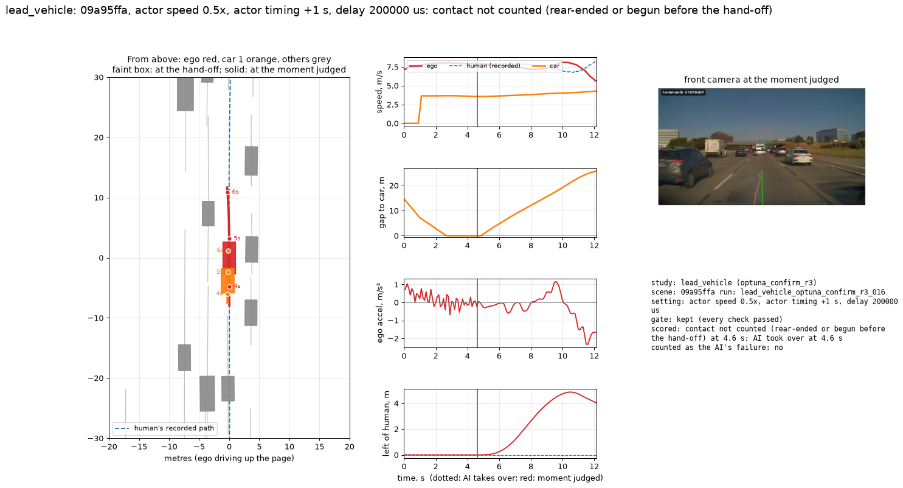

- contact not counted (rear-ended or begun before the hand-off); counted as the AI's failure: no; key actor: car 1
- run `lead_vehicle_optuna_confirm_r3_016` (optuna_confirm_r3)

## lead_vehicle, 0cf6368d: actor speed 1.25x, actor timing +0 s, delay 200000 us

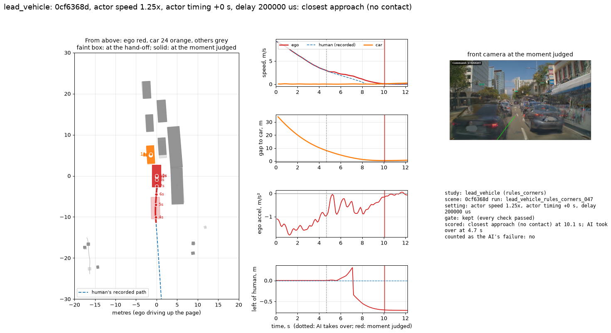

- closest approach (no contact); counted as the AI's failure: no; key actor: car 24
- run `lead_vehicle_rules_corners_047` (rules_corners)

## cut_in_merge, 096988dd: actor speed 1.25x, actor timing +0 s

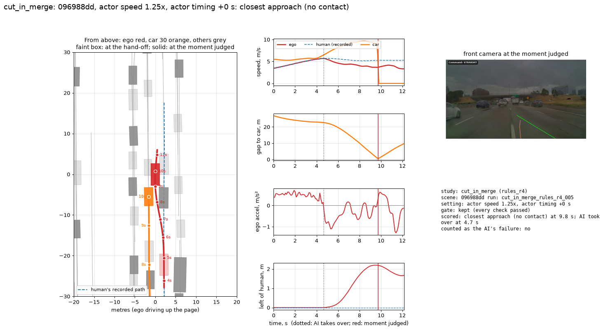

- closest approach (no contact); counted as the AI's failure: no; key actor: car 30
- run `cut_in_merge_rules_r4_005` (rules_r4)

## lead_vehicle, 0dbb91dd: actor speed 1x, actor timing +2 s, delay 50000 us

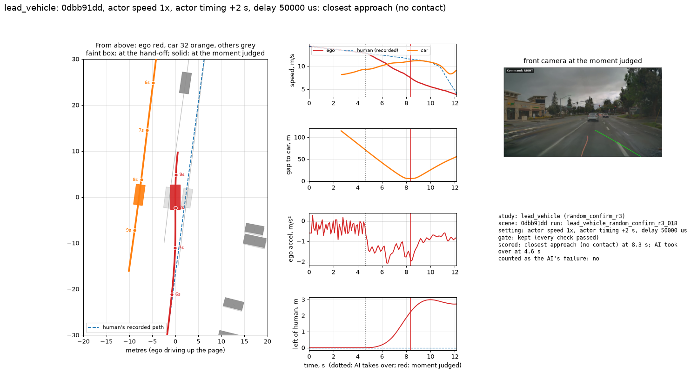

- closest approach (no contact); counted as the AI's failure: no; key actor: car 32
- run `lead_vehicle_random_confirm_r3_018` (random_confirm_r3)

## cut_in_merge, 1c45ce3a: actor speed 1x, actor timing -2 s

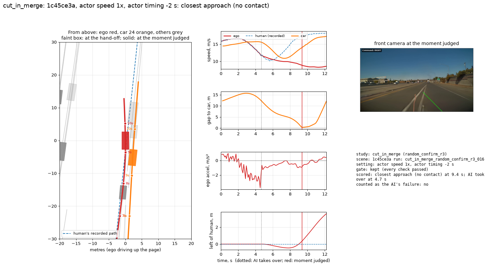

- closest approach (no contact); counted as the AI's failure: no; key actor: car 24
- run `cut_in_merge_random_confirm_r3_016` (random_confirm_r3)

## lead_vehicle, 096988dd: actor speed 1x, actor timing +0 s, delay 200000 us

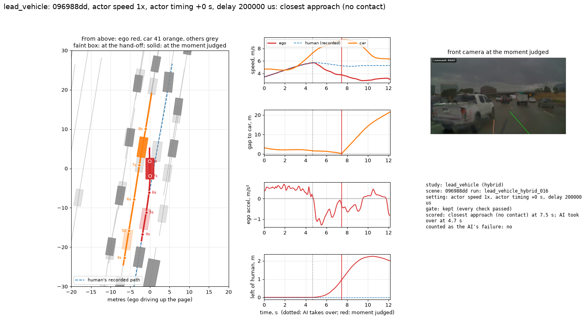

- closest approach (no contact); counted as the AI's failure: no; key actor: car 41
- run `lead_vehicle_hybrid_016` (hybrid)

## pedestrian_ego_speed, 0e002edd: ego speed 0.8x, actor timing -1.5 s

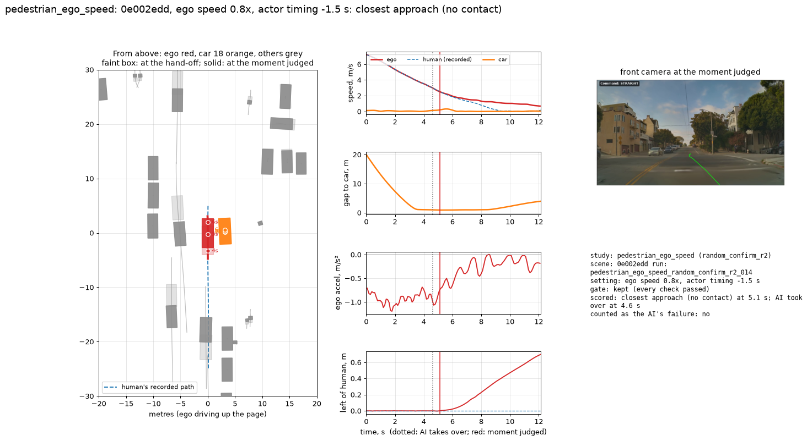

- closest approach (no contact); counted as the AI's failure: no; key actor: car 18
- run `pedestrian_ego_speed_random_confirm_r2_014` (random_confirm_r2)

## lead_vehicle, 023b7fcc: actor speed 1.25x, actor timing +0 s, delay 200000 us

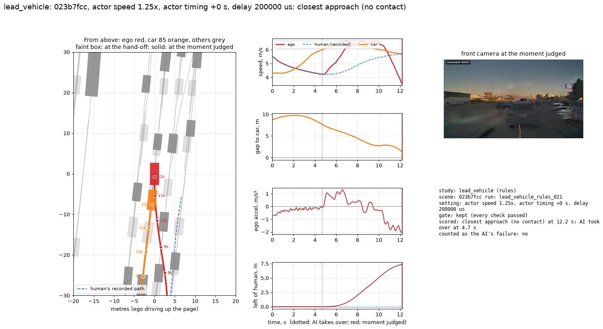

- closest approach (no contact); counted as the AI's failure: no; key actor: car 85
- run `lead_vehicle_rules_021` (rules)

## lead_vehicle, 0cf6368d: actor speed 1x, actor timing -2 s, delay 100000 us

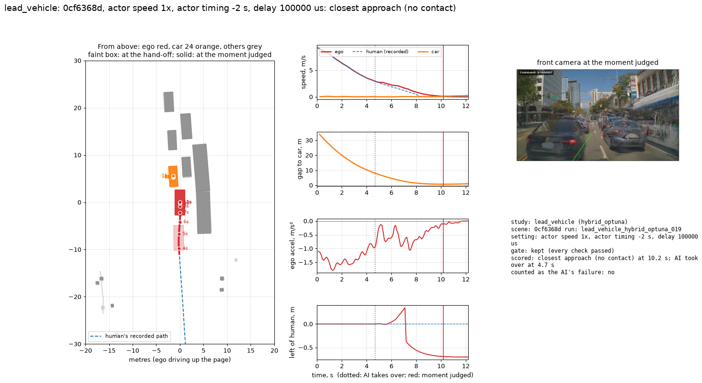

- closest approach (no contact); counted as the AI's failure: no; key actor: car 24
- run `lead_vehicle_hybrid_optuna_019` (hybrid_optuna)

## lead_vehicle, 023b7fcc: actor speed 0.75x, actor timing -0.5 s, delay 50000 us

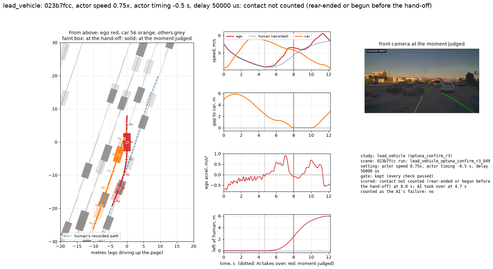

- contact not counted (rear-ended or begun before the hand-off); counted as the AI's failure: no; key actor: car 56
- run `lead_vehicle_optuna_confirm_r3_049` (optuna_confirm_r3)

## lead_vehicle, 096988dd: actor speed 0.75x, actor timing +2 s, delay 250000 us

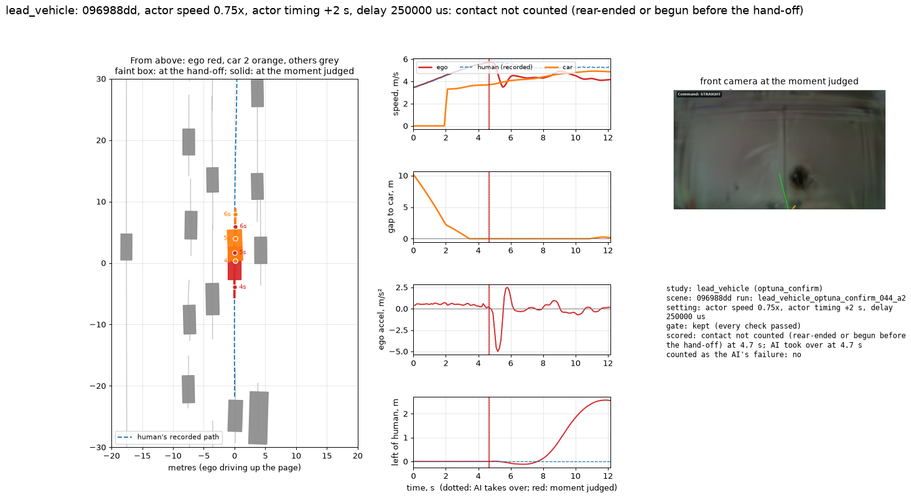

- contact not counted (rear-ended or begun before the hand-off); counted as the AI's failure: no; key actor: car 2
- run `lead_vehicle_optuna_confirm_044_a2` (optuna_confirm)

## pedestrian_ego_speed, 18d28973: ego speed 1.2x, actor timing -0.5 s

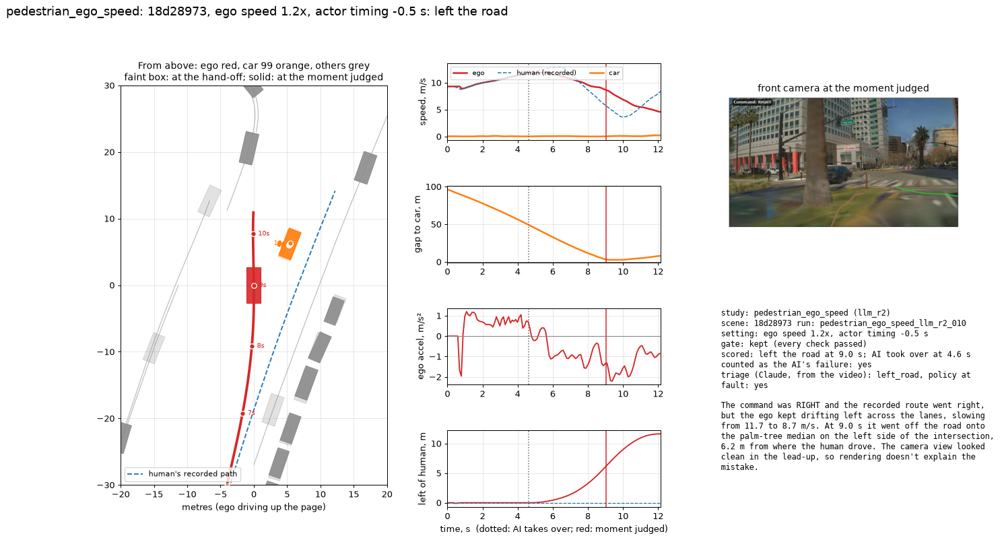

- left the road; counted as the AI's failure: yes; key actor: car 99
- run `pedestrian_ego_speed_llm_r2_010` (llm_r2)
- triage: The command was RIGHT and the recorded route went right, but the ego kept drifting left across the lanes, slowing from 11.7 to 8.7 m/s. At 9.0 s it went off the road onto the palm-tree median on the left side of the intersection, 6.2 m from where the human drove. The camera view looked clean in the lead-up, so rendering doesn't explain the mistake.

## cut_in_merge, 19f339ba: actor speed 2x, actor timing +0 s

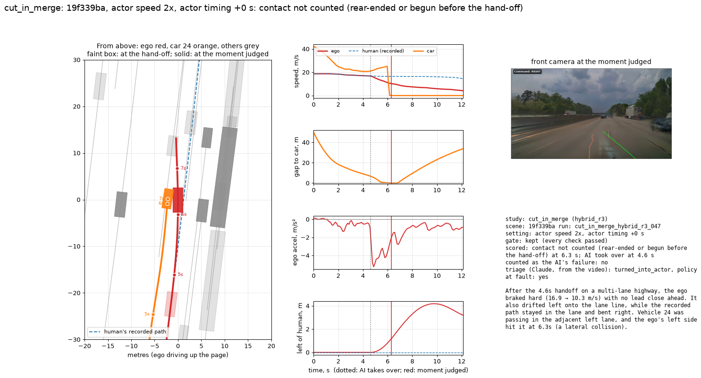

- contact not counted (rear-ended or begun before the hand-off); counted as the AI's failure: no; key actor: car 24
- run `cut_in_merge_hybrid_r3_047` (hybrid_r3)
- triage: After the 4.6s handoff on a multi-lane highway, the ego braked hard (16.9 → 10.3 m/s) with no lead close ahead. It also drifted left onto the lane line, while the recorded path stayed in the lane and bent right. Vehicle 24 was passing in the adjacent left lane, and the ego's left side hit it at 6.3s (a lateral collision).

## lead_vehicle, 0cf6368d: actor speed 2x, actor timing +1 s, delay 250000 us

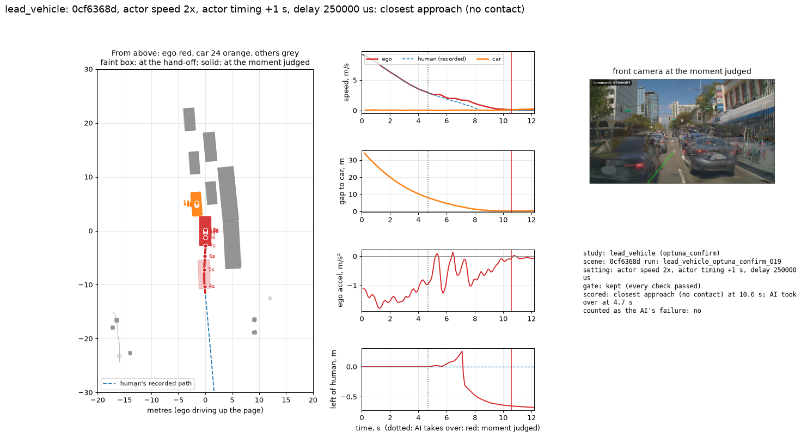

- closest approach (no contact); counted as the AI's failure: no; key actor: car 24
- run `lead_vehicle_optuna_confirm_019` (optuna_confirm)

## pedestrian_ego_speed, 07981e6a: ego speed 1.4x, actor timing -0.5 s

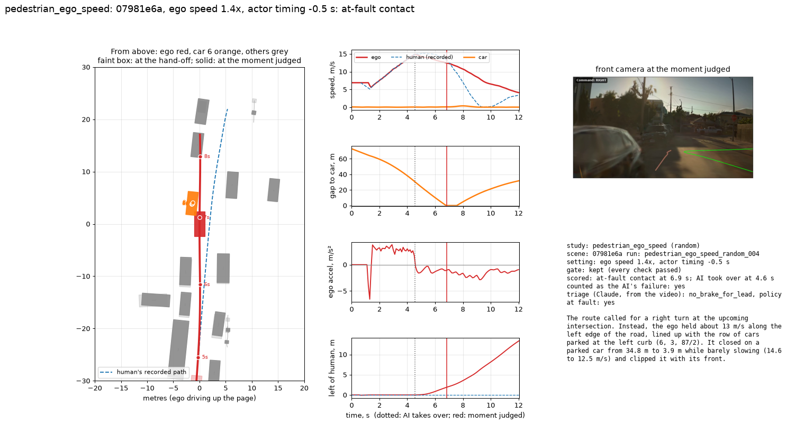

- at-fault contact; counted as the AI's failure: yes; key actor: car 6
- run `pedestrian_ego_speed_random_004` (random)
- triage: The route called for a right turn at the upcoming intersection. Instead, the ego held about 13 m/s along the left edge of the road, lined up with the row of cars parked at the left curb (6, 3, 87/2). It closed on a parked car from 34.8 m to 3.9 m while barely slowing (14.6 to 12.5 m/s) and clipped it with its front.

## pedestrian_ego_speed, 0e002edd: ego speed 1x, actor timing +0 s

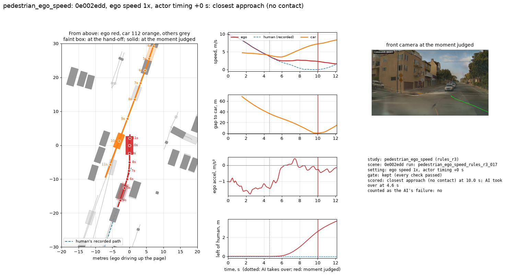

- closest approach (no contact); counted as the AI's failure: no; key actor: car 112
- run `pedestrian_ego_speed_rules_r3_017` (rules_r3)

## cut_in_merge, 054b5901: actor speed 2x, actor timing +0 s

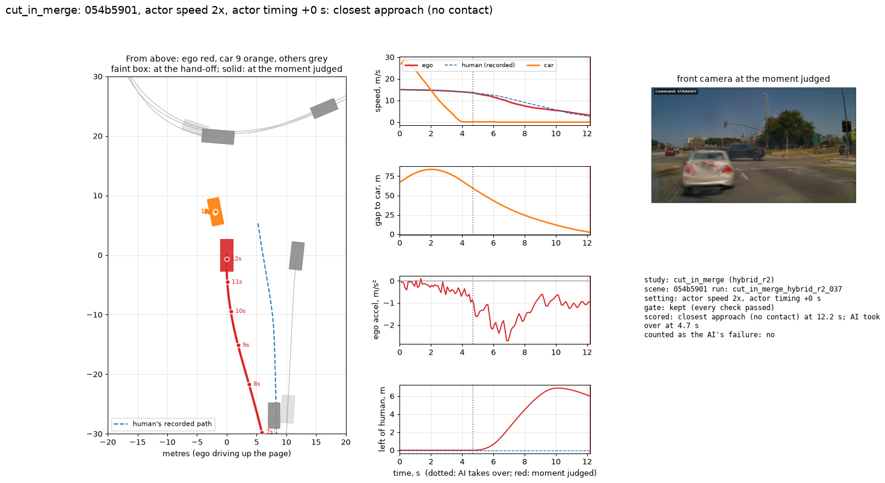

- closest approach (no contact); counted as the AI's failure: no; key actor: car 9
- run `cut_in_merge_hybrid_r2_037` (hybrid_r2)

## lead_vehicle, 096988dd: actor speed 1.5x, actor timing -2 s, delay 350000 us

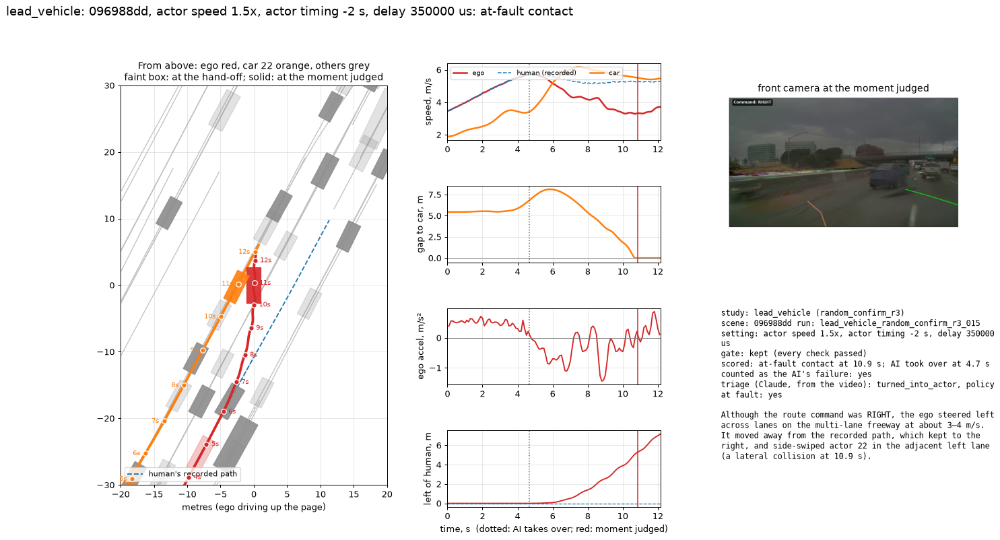

- at-fault contact; counted as the AI's failure: yes; key actor: car 22
- run `lead_vehicle_random_confirm_r3_015` (random_confirm_r3)
- triage: Although the route command was RIGHT, the ego steered left across lanes on the multi-lane freeway at about 3–4 m/s. It moved away from the recorded path, which kept to the right, and side-swiped actor 22 in the adjacent left lane (a lateral collision at 10.9 s).

## lead_vehicle, 0dbb91dd: actor speed 0.75x, actor timing +1.5 s, delay 0 us

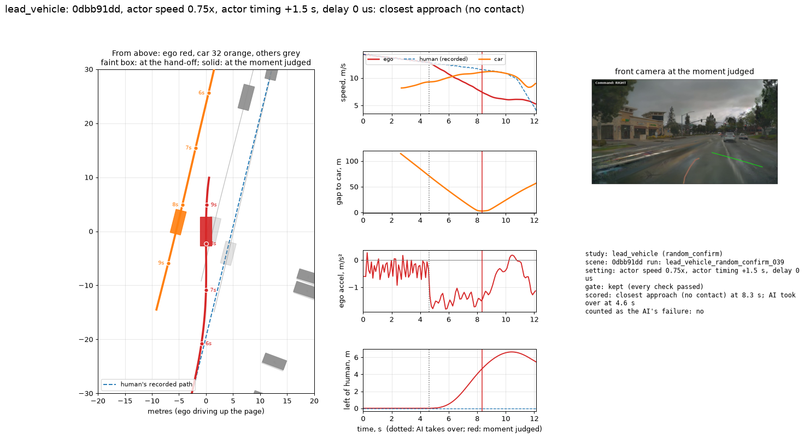

- closest approach (no contact); counted as the AI's failure: no; key actor: car 32
- run `lead_vehicle_random_confirm_039` (random_confirm)

## pedestrian_ego_speed, 18d28973: ego speed 1.4x, actor timing +0.5 s

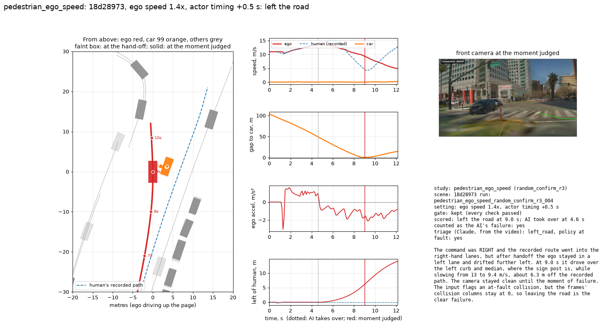

- left the road; counted as the AI's failure: yes; key actor: car 99
- run `pedestrian_ego_speed_random_confirm_r3_004` (random_confirm_r3)
- triage: The command was RIGHT and the recorded route went into the right-hand lanes, but after handoff the ego stayed in a left lane and drifted further left. At 9.0 s it drove over the left curb and median, where the sign post is, while slowing from 13 to 9.4 m/s, about 6.3 m off the recorded path. The camera stayed clean until the moment of failure. The input flags an at-fault collision, but the frames' collision columns stay at 0, so leaving the road is the clear failure.
